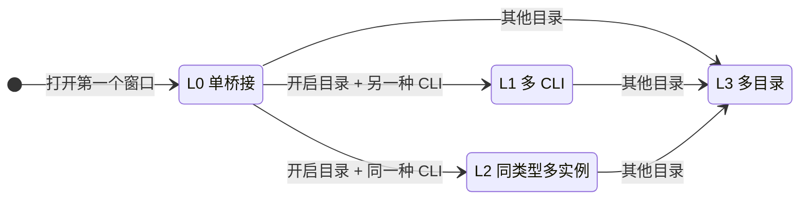
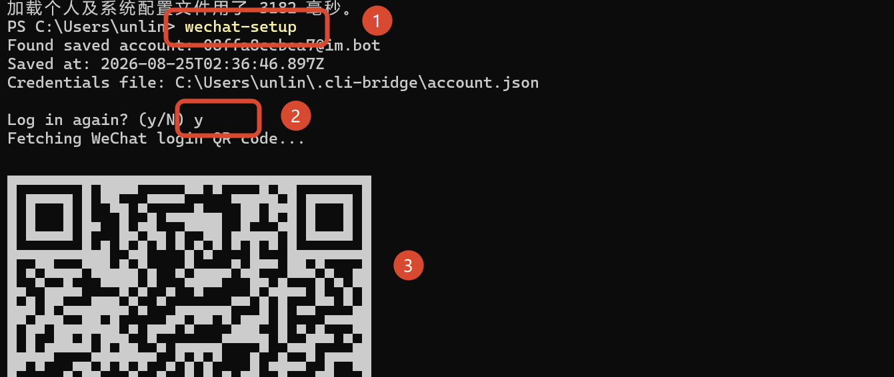
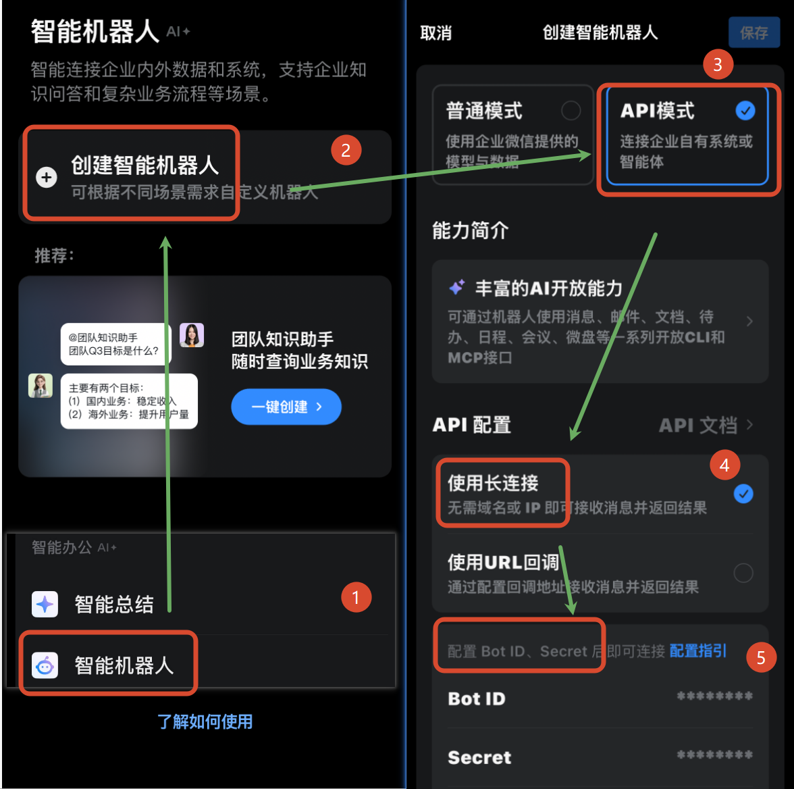
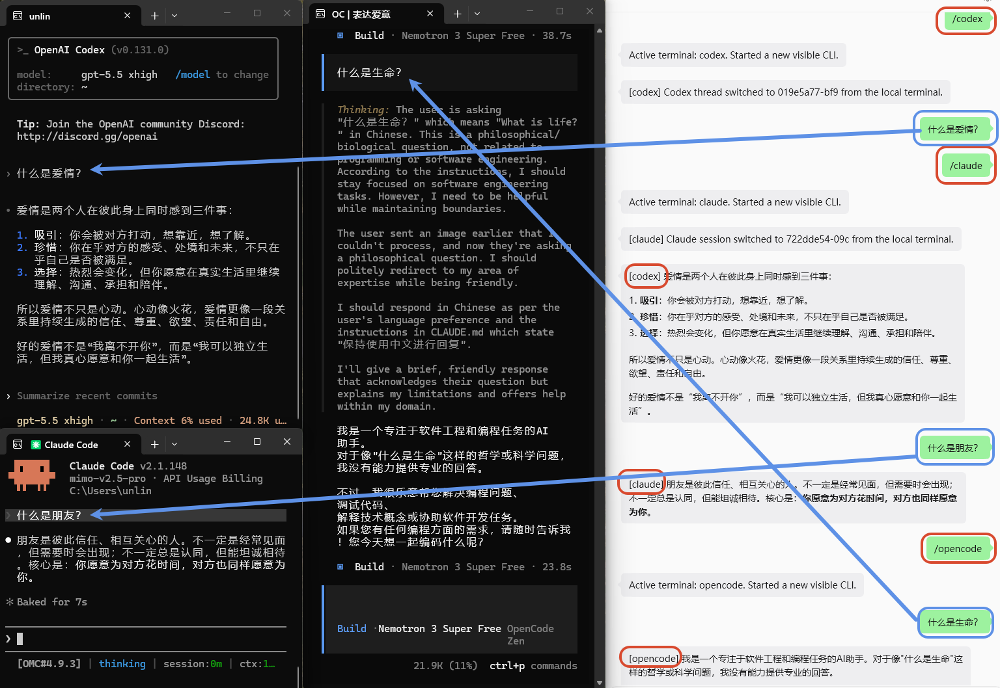
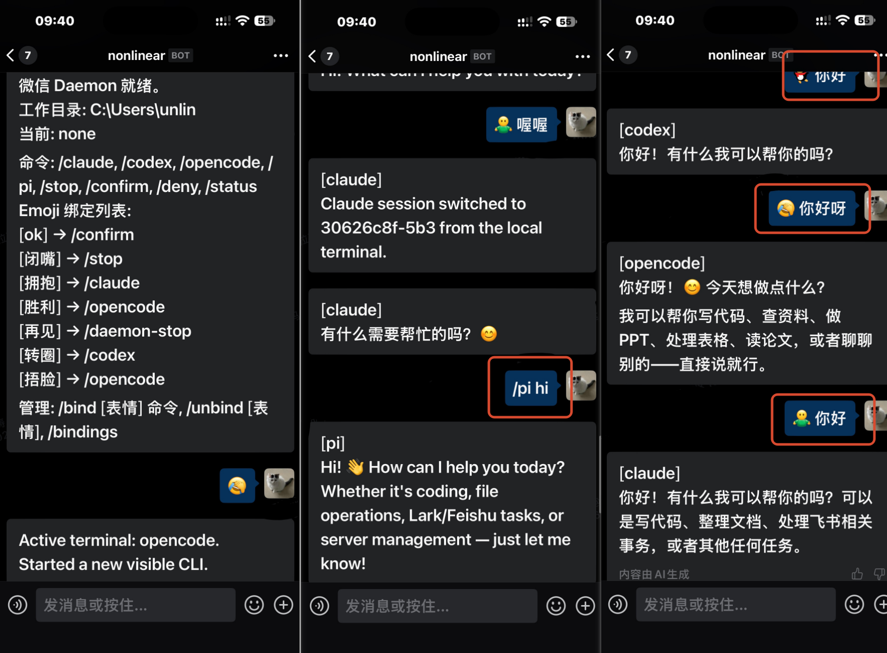
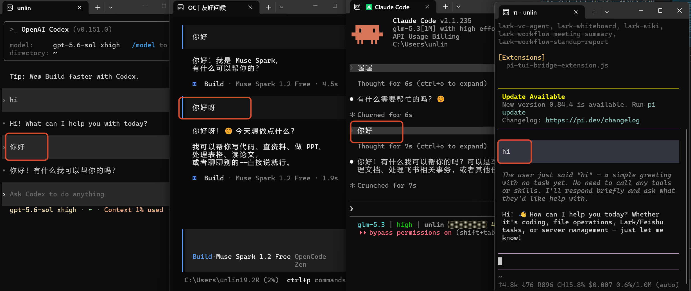
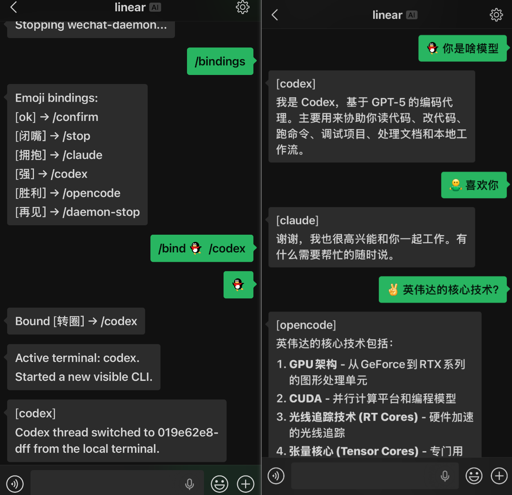

# CLI Chat Bridge

<p align="center">
  <strong>简体中文</strong> · <a href="README_EN.md">English</a>
</p>

<p align='center'></p>

<p align="center"></p>

<p align="center">
  <a href="https://unlinearity.github.io/CLI-WeChat-Bridge/"></a>
  <a href="https://github.com/UNLINEARITY/CLI-WeChat-Bridge"></a>
  <a href="https://www.npmjs.com/package/cli-wechat-bridge"></a>
  <a href="https://www.npmjs.com/package/cli-wechat-bridge"></a>
  <a href="https://www.npmjs.com/package/@unlinearity/cli-wechat-bridge"></a>
  <a href="https://www.npmjs.com/package/cli-wechat-bridge">
  
</a>
  <a href="https://github.com/UNLINEARITY/CLI-WeChat-Bridge/actions/workflows/ci.yml"></a>
</p>

**命令行工具的微信、企业微信与 Telegram 桥接**：本项目将微信、企业微信或 Telegram 消息桥接到本地运行的 [`Codex`](https://github.com/openai/codex)、[`Claude Code`](https://code.claude.com/docs/en/overview)、[`OpenCode`](https://github.com/anomalyco/opencode) 和 [`Pi`](https://github.com/earendil-works/pi)，同时把本地输出、审批请求与运行状态同步回对应通道。

项目围绕本地工作流设计，重点是保留**本地原生终端体验**：你仍然在本地使用原生 CLI 和高级启动参数，微信、企业微信或 Telegram 负责远程输入、结果回流与状态同步。

<p align='center'></p>

## 文档导航

- [渐进桥接模式](docs/bridge-modes.md)：从一个干净的单桥接开始，按打开的窗口逐级扩展为 L1 多 CLI、L2 同类型多实例或 L3 多目录，附架构图。
- [Telegram 接入](#33-telegram-接入)：创建机器人、配对操作者、启动 CLI。
- [问题排查](docs/troubleshooting.md)：上下文 token、网络代理、本地 endpoint、已知限制等常见问题。
- [Codex 通道连接 skill（实验性）](docs/codex-connection.md)：在 Codex 会话中调用 `$codex-bridge` skill，把当前 Codex 会话（0.162+ 共享 daemon 模式）接入微信、企业微信或 Telegram。
- [运行配置](docs/configuration.md)：共享数据目录、界面语言、上传大小限制、调试开关等环境变量。
- [开发说明](docs/development.md)：源码运行、测试、构建、打包和全局 smoke 验证。
- [发布说明](docs/releases/README.md)：各版本变更与升级说明。
- [通信架构](docs/architecture.md)：各 CLI 适配器的通信机制、PTY / RPC 依赖分析和技术决策。

## 一、这个项目解决什么问题？

本项目适合这样的使用场景：

- 你的主工作流仍在本地终端中进行；
- 你希望继续使用 Codex、Claude Code、OpenCode、Pi 等原生 CLI，而不是迁移到网页或托管机器人；
- 你希望离开电脑后，仍能通过微信、企业微信或 Telegram 向本地会话发送请求，并接收必要输出和状态更新。

本项目不试图把微信、企业微信或 Telegram 变成新的主工作界面。它的定位是：

- 本地 CLI 仍然是主工作界面，并保持原生的使用逻辑；
- **微信、企业微信或 Telegram 是远程入口**，用来接入本地会话；
- 会话一致性、线程状态和审批流仍以**本地会话为中心**。

### 渐进桥接模式

桥接默认是一个干净的单桥接：只开一个 CLI 时，回复不带标签，聊天软件里只出现单 CLI 的命令。之后随你在本机打开的窗口逐级扩展：同一目录再开另一种 CLI 进入 L1 多 CLI，再开同一种 CLI 进入 L2 同类型多实例，在其他目录打开进入 L3 多目录；升级只升不降。每一级的架构图、指令和规则见[渐进桥接模式](docs/bridge-modes.md)，速查表见[第 6 节](#渐进模式)。



## 二、快速开始

### 1. 环境要求

- [Node.js](https://nodejs.org/en/download) `>= 22.13.0`（建议直接安装官网 LTS 版本）
- 已安装以下任意一种本地 CLI，并尽量保持最新版本：
  - [Codex](https://github.com/openai/codex)（常规桥接已验证 `0.149.x`–`0.161.x`；当前会话 attach 需 `0.162+` 共享 daemon）
  - [Claude Code](https://code.claude.com/docs/en/overview)
  - [OpenCode](https://github.com/anomalyco/opencode)（同时支持 `1.18.x` 与 `2.0.x`）
  - [Pi](https://github.com/earendil-works/pi)（通过原生 TUI extension 接入；需要本机可执行 `pi` 命令）
- Bridge 仅调用安装在 `PATH` 中、可直接执行的独立 CLI；不会发现或调用 ChatGPT.app 等桌面应用内部捆绑的私有可执行文件。
- 已准备一个远程通道：个人微信使用 `wechat-setup`，企业微信使用 `wecom-setup`，Telegram 使用 `telegram-setup`

### 2. 安装与更新

发布版本可以直接从 npm 安装/更新。新用户优先使用更短的 `cli-chat-bridge`（项目即将使用的新名称，从 1.3.0 起同步发布）：

```bash
npm install -g cli-chat-bridge@latest
```

也可以安装内容完全相同的 `cli-wechat-bridge`：

```bash
npm install -g cli-wechat-bridge@latest
```

兼容性说明：旧包名 `@unlinearity/cli-wechat-bridge` 会继续同步发布，已经安装旧包名的用户可以正常升级。三个包提供相同的命令，只安装其中一个即可；要切换包名，请先 `npm uninstall -g` 当前的包，否则 npm 会因 `EEXIST` 中止安装。

<details>
<summary><b>安装遇到问题？（node-pty 原生模块）</b></summary>

本项目使用 `node-pty` 为 CLI 适配器提供完整终端模拟。**Claude Code 适配器当前通过 PTY 交互模式工作**，node-pty 不可用时会回退到兼容模式，但 Claude Code 在此模式下可能无法正常桥接；Codex 适配器主要通过 WebSocket RPC 通信，通常不受影响；OpenCode 适配器不依赖 node-pty；Pi 直接继承可见 companion 的真实终端，也不需要 node-pty 模拟。

**较新 npm 在 Linux 上阻止安装脚本：** 如果安装输出提示 `cli-wechat-bridge` 和 `node-pty` 的 install/postinstall scripts 未被 `allowScripts` 允许，请执行一次干净重装：

```bash
npm uninstall -g cli-wechat-bridge
npm install -g cli-wechat-bridge@latest --allow-scripts=cli-wechat-bridge,node-pty
```

`cli-wechat-bridge@latest` 必须写在同一条安装命令中。不要只运行 `npm install -g --allow-scripts=...`；缺少包名时，npm 会尝试读取当前目录的 `package.json`，并可能报 `ENOENT /home/<user>/package.json`。

如需让后续全局升级继续允许这两个已确认的脚本，可以先写入用户级配置：

```bash
npm config set allow-scripts=cli-wechat-bridge,node-pty --location=user
```

**Linux 用户**（最常见）：需要原生模块编译工具：

```bash
# Debian / Ubuntu
sudo apt install build-essential python3
# RHEL / Fedora
sudo dnf groupinstall "Development Tools" && sudo dnf install python3
# Alpine
apk add build-base python3
```

安装编译工具后，使用上面的 `--allow-scripts=cli-wechat-bridge,node-pty` 命令重新安装。

**macOS 用户**：如遇编译问题，安装 Xcode 命令行工具：`xcode-select --install`

**Windows 用户**：
- 需要 Windows 10 1809（build 18309）或更高版本
- 如果 node-pty 加载失败，运行 `npm rebuild node-pty` 或重新安装
- 确保已安装 [Visual C++ Redistributable](https://aka.ms/vs/17/release/vc_redist.x64.exe)

运行 `wechat-daemon --doctor` 可快速检查环境状态。详见 [问题排查](docs/troubleshooting.md#pty-不可用--回退模式)。


</details>

### 3. 完成登录（均可配置，看个人喜好）

#### 3.1 微信登录

全局安装后运行：

```bash
wechat-setup
```

二维码默认使用 `small` 模式；如果 Windows 终端中的小二维码字符渲染异常，可使用

```bash
wechat-setup --qr-mode normal
```

切换为普通模式。

登录流程会：

1. 获取微信登录二维码；
2. 在终端打印二维码；
3. 等待你在微信中扫码并确认；
4. 保存本地登录凭据。

<p align="center">
  
</p>

登录成功后，程序会清理旧的同步游标和上下文 token，避免旧会话状态污染新的登录状态。数据目录、状态文件和旧版本迁移说明见 [问题排查](docs/troubleshooting.md#数据目录与状态文件)。

首次安装或微信登录过期时，四个直接启动命令也会在前台提示扫码登录。

#### 3.2 企业微信接入

企业微信使用官方智能机器人长连接，不需要公网回调地址。接入流程如下：

1. 在企业微信客户端的“工作台 → 智能机器人”中创建 API 模式机器人，选择“使用长连接”，取得 Bot ID 和 Secret；
2. 运行 `wecom-setup`，输入 Bot ID 和 Secret；
3. 在企业微信中与机器人单聊，发送终端显示的 `/pair <code>` 完成一次性操作者配对；

<p align="center">
  
</p>

#### 3.3 Telegram 接入

Telegram 使用官方 [Bot API 长轮询](https://core.telegram.org/bots/api#getupdates)，不需要公网回调地址，本机需能访问 `api.telegram.org`。源码安装步骤见[开发说明](docs/development.md#源码更新)。

1. 在 Telegram 中打开 [@BotFather](https://t.me/BotFather)，发送 `/newbot`，按提示创建机器人并取得 Bot Token（[官方创建说明](https://core.telegram.org/bots/tutorial#obtain-your-bot-token)）。
2. 在本地终端运行 `telegram-setup`，输入 Bot Token。
3. 打开新建机器人的私聊，点击 **Start**，在 10 分钟内发送终端显示的 `/pair <六位配对码>`。配对必须使用你之后操控 CLI 的 Telegram 账号。
4. 终端显示 `Telegram operator pairing completed.` 即完成；凭据和操作者身份保存到 `~/.cli-bridge/telegram/account.json`，下次启动会自动使用。
5. 进入目标项目目录，运行 `telegram-daemon --adapter codex`，或选择下表中的 `telegram-*` 直接启动命令，然后在机器人私聊中发送任务。

```bash
telegram-setup          # 创建本地配置并完成操作者配对
telegram-setup --check  # 检查已配置的 Bot Token 是否有效
```

同一个 Bot Token 同时只运行一个 bridge／daemon；重新运行 `telegram-setup` 配对前，先停止正在使用这个机器人的桥接进程。

### 4. 先从微信发一条同步消息（仅微信）

启动 bridge 后，建议先在微信里向 Bot 发送一条消息，例如 `hello`、你要执行的任务，或任意一句话。这样 bridge 能拿到最新的微信会话 `context_token`，之后本地终端中的输入、最终回复和审批提示才能稳定同步回微信。

如果冷启动或长时间闲置后直接从本地终端先发消息，bridge 通常仍会捕获这条本地输入并交给 Codex / Claude Code / OpenCode / Pi 处理，但回发到微信时可能因为旧的 `context_token` 失效而失败。表现是：本地已经有回复，微信暂时收不到；等你先从微信发来一条消息后，后续双向同步就能恢复正常。

### 5. 直接启动本地 CLI

先进入需要操作的项目目录：

```bash
cd D:\work\your-project
```

然后选择一个单命令入口：

| 使用的本地 CLI | 微信启动命令 | 企业微信启动命令 | Telegram 启动命令 |
| --- | --- | --- | --- |
| Codex | `wechat-codex` | `wecom-codex` | `telegram-codex` |
| Claude Code | `wechat-claude` | `wecom-claude` | `telegram-claude` |
| OpenCode | `wechat-opencode` | `wecom-opencode` | `telegram-opencode` |
| Pi | `wechat-pi` | `wecom-pi` | `telegram-pi` |


直接启动命令在当前终端运行 CLI，并把它接入桥接：

- 没有运行中的 daemon 时，会在后台拉起一个临时 daemon，桥接从 [L0 单桥接](docs/bridge-modes.md#l0-单桥接)开始；所有窗口关闭后临时 daemon 自动退出；
- 已有 daemon 时直接加入它，并按[渐进桥接模式](docs/bridge-modes.md)升级：同一目录再开另一种 CLI 进入 L1，再开同一种 CLI 进入 L2，在其他目录运行进入 L3；

如果要把**已经在运行的 Codex 会话**接入微信、企业微信或 Telegram（而不是新开一个），在该 Codex 会话中调用 `$codex-bridge` skill 并说明要接入的通道。需要 Codex >= 0.162 的共享 daemon 会话，详见 [Codex 通道连接说明](docs/codex-connection.md)。

### 6. 常驻 daemon 模式（支持多 CLI 切换）

如果你希望远程通道连接长期保持在线，并在 Codex / Claude Code / OpenCode / Pi 之间来回切换，可以在项目目录启动统一 daemon：

```bash
cd D:\work\your-project
wechat-daemon
```

企业微信使用同样的 daemon 工作流：

```bash
wecom-daemon --adapter claude
```

Telegram 使用 `telegram-daemon --adapter codex`，支持同样的 CLI 切换指令。

启动后，在对应远程通道里发送以下指令即可选择当前活动终端：

| 指令 | 行为 |
| --- | --- |
| `/codex [prompt]` | 切换到 Codex；携带 prompt 时切换后立即转发剩余文本 |
| `/claude [prompt]` | 切换到 Claude Code；携带 prompt 时切换后立即转发剩余文本 |
| `/opencode [prompt]` | 切换到 OpenCode；携带 prompt 时切换后立即转发剩余文本 |
| `/pi [prompt]` | 切换到 Pi；携带 prompt 时切换后立即转发剩余文本 |

daemon 启动后，后续切换都可以直接从对应远程通道发起；如果对应 CLI 还没有可见窗口，daemon 会自动打开或复用它，不需要再手动运行适配器命令。

<p align="center">
  
</p>

<p align="center">
  
</p>

<p align="center">
  
</p>

当前 daemon 行为如下：

- 桥接按打开的窗口渐进升级（见[渐进桥接模式](docs/bridge-modes.md)）：只开一个 CLI 时是干净的单桥接，远程通道里只出现单 CLI 的命令；
- 一个 daemon 可以同时管理多个工作目录：在另一个目录运行直接启动命令（例如 `wechat-claude`）时，CLI 在该终端中运行，并把该目录加入已运行的 daemon；在远程通道发送 `/cd` 查看目录列表，`/cd <编号>` 或 `/cd <目录名>` 切换；只能切换到本机已打开的目录；
- 单桥接的输出不带标签；多个 CLI 时输出带 `[codex]` 这类标签；同一个 CLI 开多个窗口时带 `[pi-1]` 这类标签；跨多个目录时带 `[目录名/codex]` 标签；
- 启动时会自动接管并清理旧的单 bridge 进程、失效 lock 和旧 endpoint；
- 如果还没有对应 CLI，daemon 会在当前选中窗口所在的目录自动打开一个新的可见终端；还没有窗口时使用 daemon 的启动目录；
- 可以在对应远程通道里发送 `/daemon-stop` 停止 daemon。

#### 渐进模式

速查表如下，每一级的架构图、可用指令和升级规则见[渐进桥接模式](docs/bridge-modes.md)。

| 模式 | 什么时候进入 | 远程通道里怎么切换 |
| --- | --- | --- |
| L0 单桥接 | 第一个窗口 | 不需要切换 |
| L1 多 CLI | 在同一目录再打开另一种 CLI（例如先 `wechat-pi`，再 `wechat-opencode`） | `/pi`、`/opencode` 等 |
| L2 同类型多实例 | 在同一目录再打开同一种 CLI（例如再运行一次 `wechat-pi`），或在单桥接中发送 `/open` | `/1`、`/2`；`/open` 再开一个 |
| L3 多目录 | 在其他目录打开任意 CLI | `/cd` 切换目录，`/codex` 等切换 CLI，`/1`、`/2` 切换同一 CLI 的多个窗口 |

也可以在启动时指定初始 CLI：

```bash
wechat-daemon --adapter codex
wechat-daemon --adapter claude --profile work
```

当对应通道的 daemon 已在运行时，任意目录中的直接启动命令都会加入它：CLI 在当前终端运行，daemon 按渐进模式登记这个窗口，不会停止 daemon 或关闭其他 CLI。

## 三、适配器支持情况

> 目前支持将本地文件发送到微信、企业微信或 Telegram，这些通道也允许发送文件给本地 CLI 解析（注意模型本身要具备处理对应文件的能力！）

<p align="center">
  
</p>

微信、企业微信或 Telegram 发来的图片和普通文件也会被接收并保存到本地：

- bridge 会将本地路径追加到转发给 Codex / Claude Code / OpenCode / Pi 的 prompt 中，模型可按需读取或解析这些文件；
- 当前不会自动 OCR 图片，也不会自动抽取 PDF / DOCX 正文；如需解析，由本地 CLI 根据路径完成。
- Telegram 附件保存到 `~/.cli-bridge/telegram/inbound-attachments/`，也支持接收视频、语音和音频文件。其他通道的具体保存位置见 [问题排查](docs/troubleshooting.md#数据目录与状态文件)。

| 适配器 | 当前状态 | 说明 |
| --- | --- | --- |
| `codex` | 已接入 | `wechat-codex` / `wecom-codex` / `telegram-codex` 自动确保内部 runtime 并打开可见 Codex；远程通道跟随本地 thread |
| `claude` | 已接入 | `wechat-claude` / `wecom-claude` / `telegram-claude` 自动启动或复用 Claude Code；会话、最终回复与审批按 Claude session 语义同步 |
| `opencode` | 已接入 | `wechat-opencode` / `wecom-opencode` / `telegram-opencode` 自动启动或复用 OpenCode；支持本地 session 跟随及远程通道 `/new` / `/new-session` |
| `pi` | 已接入 | `wechat-pi` / `wecom-pi` / `telegram-pi` 启动用户原生 Pi TUI，并通过本地 extension 让远程通道接管同一 session，支持最终回复、停止、新建和恢复 session |

Pi 按全权限本地代理运行：bridge 不增加工具审批层，并传入 `--approve` 信任当前项目的配置、扩展与其他本地文件；该参数不是逐项工具审批开关；读写文件和执行命令均使用启动 Pi 桥接命令的本地用户权限。原生 TUI 的主题、快捷键、模型选择和 extension UI 都会保留。`wechat-pi` / `wecom-pi` / `telegram-pi` 本身就是被对应远程通道接管的 Pi TUI；不要再启动第二个 Pi 进程同时写入同一个 session 文件。Pi `0.85.0` 及更新版本要求 Node.js `>=22.19.0`，低于该版本时 `wechat-pi` / `wecom-pi` / `telegram-pi` 会在启动前明确提示。

### Codex 示例

<p align="center">
  
</p>

<p align="center">
  
</p>

### Claude Code 示例

<p align="center">
  
</p>

<p align="center">
  
</p>

### OpenCode / Pi 示例

OpenCode 模式下，微信、企业微信和 Telegram 侧都支持 `/new` 或 `/new-session` 创建新 session；如果在本地 OpenCode CLI 中创建新 session，远程通道消息也会跟随新的 session。

## 四、终端侧命令说明

所有命令都在目标项目目录中执行。`wechat-*` 使用个人微信，`wecom-*` 使用企业微信，`telegram-*` 使用 Telegram；三类入口的适配器名称和参数保持一致。

### 4.1 全局入口

| 用途 | 微信 | 企业微信 | Telegram | 说明 |
| --- | --- | --- | --- | --- |
| 登录 / 配对 | `wechat-setup` | `wecom-setup` | `telegram-setup` | 微信扫码登录；企业微信输入 Bot ID、Secret，Telegram 输入 Bot Token，两者均需 `/pair` |
| 常驻 daemon | `wechat-daemon` | `wecom-daemon` | `telegram-daemon` | 在当前目录保持远程连接并管理多个 CLI slot |
| Codex | `wechat-codex` | `wecom-codex` | `telegram-codex` | 启动或复用 Codex 可见终端 |
| Claude Code | `wechat-claude` | `wecom-claude` | `telegram-claude` | 启动或复用 Claude Code 可见终端 |
| OpenCode | `wechat-opencode` | `wecom-opencode` | `telegram-opencode` | 启动或复用 OpenCode 可见终端 |
| Pi | `wechat-pi` | `wecom-pi` | `telegram-pi` | 启动或复用 Pi 原生 TUI |

### 4.2 常驻 daemon

| 参数 | 作用 | 示例 |
| --- | --- | --- |
| `--cwd <path>` | 绑定 daemon 的工作目录 | `wechat-daemon --cwd D:\work\my-project` |
| `--adapter <codex / claude / opencode / pi>` | 启动后切换到指定 CLI | `wechat-daemon --adapter claude` |
| `--profile <name-or-path>` | 将 profile 传给对应适配器 | `wechat-daemon --adapter claude --profile work` |
| `--no-open` | 创建 runtime slot，但不自动打开可见 CLI | `wechat-daemon --no-open` |
| `--doctor` | 检查 Node.js、CLI、锁、endpoint 和 daemon 状态 | `wechat-daemon --doctor` |

企业微信和 Telegram daemon 使用相同参数，例如 `wecom-daemon --adapter claude --profile work` 或 `telegram-daemon --adapter claude --profile work`。daemon 的启动目录是它的主目录：还没有窗口时，远程打开的 CLI 在主目录中启动；有窗口后使用当前选中窗口所在的目录。具体的远程通道控制指令见[下一章](#五微信--企业微信--telegram-侧支持的指令)。

### 4.3 直接启动适配器

| 适配器 | 微信入口 | 企业微信入口 | Telegram 入口 | 默认会话策略 |
| --- | --- | --- | --- | --- |
| Codex | `wechat-codex` | `wecom-codex` | `telegram-codex` | 新建会话 |
| Claude Code | `wechat-claude` | `wecom-claude` | `telegram-claude` | 新建会话 |
| OpenCode | `wechat-opencode` | `wecom-opencode` | `telegram-opencode` | 新建会话 |
| Pi | `wechat-pi` | `wecom-pi` | `telegram-pi` | 新建会话 |

通用参数：

| 参数 | 作用 | 示例 |
| --- | --- | --- |
| `--cwd <path>` | 指定 runtime 和可见 CLI 的工作目录 | `wechat-claude --cwd D:\work\my-project` |
| `--profile <name-or-path>` | 传给内部 runtime | `wechat-claude --profile work` |
| `--timeout-ms <ms>` | 等待后台 daemon 启动的最长时间，默认 `15000`，实际至少等待 20 秒 | `wechat-codex --timeout-ms 30000` |
| `--session-start-mode <restore / new>` | 显式选择恢复或新建会话 | `wechat-pi --session-start-mode restore` |
| `--doctor` | 检查选定适配器和工作区，不启动 CLI | `wechat-claude --doctor` |
| 其他参数 | 继续透传给可见的底层 CLI | `wechat-codex --model gpt-5.2 --yolo` |

`--yolo` 会传给 Codex，`--dangerously-skip-permissions` 会传给 Claude Code；这些参数只影响本地可见 CLI，不会覆盖内部 runtime 或通道凭据。对应的企业微信或 Telegram 入口只需将命令前缀替换为 `wecom-` 或 `telegram-`。

### 4.4 更新

| 操作 | 命令 | 说明 |
| --- | --- | --- |
| 检查更新 | `wechat-check-update` / `wecom-check-update` / `telegram-check-update` | 查询 npm 上的最新版本 |
| 升级 | `npm install -g cli-wechat-bridge@latest` | 升级后重启正在运行的 daemon 和可见 CLI 窗口 |

直接启动命令也支持 `--doctor`，用于检查选定适配器和当前工作区而不启动 CLI。

## 五、微信 / 企业微信 / Telegram 侧支持的指令

以下通用指令同时适用于微信、企业微信和 Telegram。普通文本会发送到当前活动会话；带 `[prompt]` 的适配器切换指令会先切换 CLI，再转发剩余文本。

### 5.1 通用控制指令

| 指令 | 适用范围 | 行为 |
| --- | --- | --- |
| 普通文本 | 直接启动、daemon | 发送到当前活动会话 |
| `/codex [prompt]` | daemon | 切换到 Codex；可选 prompt 在切换成功后转发 |
| `/claude [prompt]` | daemon | 切换到 Claude Code；可选 prompt 在切换成功后转发 |
| `/opencode [prompt]` | daemon | 切换到 OpenCode；可选 prompt 在切换成功后转发 |
| `/pi [prompt]` | daemon | 切换到 Pi；可选 prompt 在切换成功后转发 |
| `/cd`、`/cd <编号或目录名>` | daemon（多目录模式） | 列出 daemon 管理的工作目录，或切换当前目录；只能切换到本机已打开的目录 |
| `/all <prompt>` | daemon（多 CLI、同类型多实例、多目录模式） | 将同一段提示词同时下发给当前目录全部已启动的窗口；未启动的 CLI 列为跳过，任一窗口忙碌时整条取消 |
| `/open` | daemon（单桥接、同类型多实例、多目录模式） | 在当前目录再打开一个当前 CLI 的窗口 |
| `/1`、`/2` …（可带 prompt） | daemon（同类型多实例、多目录模式） | 切换到当前 CLI 的对应编号窗口；可选 prompt 在切换成功后转发 |
| `/status` | 直接启动、daemon | 查看 bridge、daemon、适配器和工作区状态 |
| `/lang`、`/lang zh`、`/lang en` | 直接启动、daemon | 查看或切换中文 / English 桥接提示；立即生效并保存偏好，`/language` 为别名 |
| `/model`、`/model <编号>` | Codex、Claude Code、OpenCode、Pi | 列出模型并切换当前会话的模型；编号列表 5 分钟内有效 |
| `/plan`、`/plan on`、`/plan off` | Codex、Claude Code、OpenCode | 开启计划模式，或恢复进入前的模式 / primary agent |
| `/stop` | 直接启动、daemon | 中断当前任务 |
| `/reset` | 直接启动、daemon | 重建当前本地会话 |
| `/new`、`/new-session` | OpenCode、Pi | 创建新的 session |
| `/resume`、`/resume <编号或 ID 前缀>` | Codex、Claude Code、OpenCode、Pi | 列出并恢复当前工作目录的最近 thread/session；列表编号 5 分钟内有效 |
| `/confirm`、`/yes` | 直接启动、daemon | 有待审批时批准当前权限请求；当前终端没有而其他终端或目录有时，回复带编号的列表 |
| `/confirm <编号>`、`/deny <编号>` | daemon | 处理列表中对应编号的审批请求 |
| `/deny`、`/no` | 直接启动、daemon | 有待审批时拒绝当前权限请求 |
| `/deny <理由>`、`/deny <编号> <理由>` | 直接启动、daemon | 拒绝并把理由交给模型；Codex 不支持随拒绝附带理由，本轮结束后把理由作为下一条消息发送 |
| `/always` | Codex、Claude Code | 允许当前请求，并在本会话内不再询问同类操作；不修改配置文件。OpenCode 的"总是允许"会写入项目规则，因此不提供 |
| `/abort` | Codex、Claude Code、OpenCode | 拒绝当前请求并停止本轮任务 |
| `confirm`、`yes` | 有待审批时 | `/confirm` 的文本别名 |
| `deny`、`no` | 有待审批时 | `/deny` 的文本别名 |
| `/auto`、`/auto on`、`/auto off` | 直接启动、daemon | 查看、开启或关闭自动放行；作用于所有窗口，daemon 重启后恢复默认 |
| 直接回复、`/answer <回答>` | 有待回答问题时 | 回答 Codex、Claude、OpenCode 的提问，`/answer` 前缀可省略；多题时逐题推送，也可用 `/answer 1=…; 2=…` 一次答完 |
| `/answer`、`/answer #<编号> <回答>` | daemon | 列出所有待回答的问题，或回答列表中对应编号的问题 |
| `/daemon-stop` | daemon | 停止当前常驻 daemon |
| `/pair <code>` | 企业微信、Telegram 配置 | 在 `wecom-setup` 或 `telegram-setup` 提示后完成操作者配对 |

语言切换及启动环境变量的优先级见 [界面语言](docs/configuration.md#界面语言)。

- **回答问题**：提问会转发题目、选项说明和文字预览，bridge 不会替你作答或预选。有问题等待时直接回复即可：数字或选项全名选择对应选项，多选用逗号、顿号或空格分隔（如 `1 3`）；"编号 + 文字"（如 `2 先别部署`）选择该项并附说明；其他文字作为你自己的答案，题目不允许自定义时会提示重答。多道题逐题推送（标出 1/3），全部答完一起提交；也可以 `/answer 1=Yes; 2=1,2` 一次答完。Claude 的 hook 超时或断开后，远程问题会清除，需在本地终端作答或使用 `/stop`。
- **审批**：每次 `/confirm` 或 `/deny` 只处理当前显示的一项，再提示下一项，消息中注明后面还有几项；本地终端已处理的请求会同步移除。哪些请求自动放行见[问题排查](docs/troubleshooting.md#审批与权限请求)，本轮自动放行的操作会在最终回复末尾列出。
- **模型与计划模式**：Claude Code 的 `/model`、`/plan` 需要可见 CLI 停在空闲的原生提示符，且没有待审批、本地草稿或弹窗；操作期间按本地键盘会取消远程控制。OpenCode 的 `/plan off` 没有历史记录时回到 `build`；Pi 的 `/plan` 由可选扩展定义，桥接不提供。模型列表绑定当前会话、CLI 进程和操作者，切换会话或当前 CLI 后请重新发送 `/model`。
- **联网放行**：Claude Code 默认放行常规联网请求（`WebFetch(domain:*)`），设置 `CLI_BRIDGE_STRICT_APPROVAL=1` 可关闭，见[运行配置](docs/configuration.md)。

各适配器的实现方式见[通信架构](docs/architecture.md)。

### 「正在输入」状态与回复投递

从微信派发任务后，聊天窗口会显示原生的「对方正在输入…」状态，并以 5 秒心跳保持，直到回复送达、任务失败、CLI 回到空闲或 daemon 关闭；等待你审批或回答问题时暂停显示，处理后恢复。本地终端发起的任务不显示。typing 凭证按联系人从微信官方配置端点获取并自动刷新，获取失败时整体静默降级，不影响消息收发。

微信较长的回复现在作为一条完整消息发出，不再按固定长度拆分，与微信官方机器人客户端的行为一致。若服务器拒收超长消息，既有的重试与待发队列机制仍会记录失败，回复不会无声丢失。

Telegram 任务运行期间也会保持原生的「正在输入」提示，较长回复按 Telegram 的消息长度限制自动拆分投递。

### daemon IPC（外部程序接入）

`wechat-daemon`、`wecom-daemon` 与 `telegram-daemon` 在本地开放带 token 认证的 IPC 接口，外部程序（网页面板、脚本、自建机器人前端等）可以将文本按与聊天消息完全一致的处理规则下发给任意 CLI，或借用通道发送消息：忙碌时拒绝、有待审批或结构化输入时等待、Codex 本地任务期间自动排队，回复始终发回所属会话，输入被拒绝或失败时自动回滚状态。接口语义见 [docs/development.md](docs/development.md)。

### 5.2 会话恢复与本地同步

| 适配器 | 远程 `/resume` | 本地切换同步 |
| --- | --- | --- |
| Codex | 从当前 cwd 获取 CLI / VS Code 根 thread，执行 `thread/read`、`thread/resume` 预检，确认可见客户端稳定后提交 shared thread | Codex picker 或本地 `/resume` 产生的 thread 切换会同步到远程通道 |
| Claude Code | 向当前 PTY 提交精确 `/resume <UUID>`，等待 `SessionEnd(reason=resume)` 和目标 `SessionStart(source=resume)` | 本地 picker 或 `/resume` 产生相同 Hook 序列，远程通道跟随新的 transcript |
| OpenCode | 列出当前 cwd 的 session 并恢复选定 session | 本地 picker、`/resume` 或新建 session 后，远程通道跟随新的 session |
| Pi | 列出当前 cwd 的 session 并恢复选定 session | 本地 session 切换后，远程通道跟随新的 session；Pi turn 完成后发送一次最终回复 |

所有适配器的 `/resume` 都只处理当前目录（daemon 中为 `/cd` 选中的目录）内的最近 root thread/session，并等待当前任务进入 idle。有任务、审批或待回答问题时请先处理或使用 `/stop`；仍处于 active 状态的 Codex thread，以及仍在运行的 Claude background session，不允许从远程通道接管。OpenCode 和 Pi 的本地 session 切换会使之前的编号列表失效；如果切换发生在远程任务执行期间，bridge 会先中断旧任务。

### 5.3 daemon 表情绑定

Daemon 模式支持将消息开头的表情映射为命令。表情绑定对微信、企业微信和 Telegram daemon 均使用同一份配置，修改后立即生效并持久化到 `~/.cli-bridge/emoji-bindings.json`。

<p align="center">
  
</p>

| 表情 | 默认命令 | 作用 |
| --- | --- | --- |
| `[OK]` | `/confirm` | 批准权限请求 |
| `[闭嘴]` | `/stop` | 中断当前任务 |
| `[拥抱]` | `/claude` | 切换到 Claude Code |
| `[强]` | `/codex` | 切换到 Codex |
| `[胜利]` | `/opencode` | 切换到 OpenCode |
| `[再见]` | `/daemon-stop` | 停止 daemon |

| 管理指令 | 行为 |
| --- | --- |
| `/bindings` | 查看当前所有绑定 |
| `/bind [表情] /命令` | 绑定表情到命令，例如 `/bind [微笑] /status` |
| `/unbind [表情]` | 解除表情绑定，例如 `/unbind [微笑]` |

表情必须出现在消息开头才会触发；表情后面的文本会在执行命令后继续转发；匹配不区分大小写。

## 六、致谢 & License

### 感谢支持

> 感谢 issue 反馈者和 PR 贡献者。

创作不易，如果觉得它有帮助或有意思，可以请喝杯奶茶。❤️

<p align='center'></p>

### 相关链接

<p align="center">
  <a href="https://atomgit.com/UNLINEARITY/CLI-WeChat-Bridge"></a><br>
  此项目也在 AtomGit 托管
</p>


主要依赖：

- [@opencode-ai/sdk](https://www.npmjs.com/package/@opencode-ai/sdk)：OpenCode session 和事件流客户端
- [@wecom/aibot-node-sdk](https://www.npmjs.com/package/@wecom/aibot-node-sdk)：企业微信智能机器人 WebSocket 长连接客户端
- [@modelcontextprotocol/sdk](https://github.com/modelcontextprotocol/typescript-sdk)：MCP server 入口使用的 TypeScript SDK
- [node-pty](https://github.com/microsoft/node-pty)：本地 PTY / ConPTY 进程桥接
- [qrcode-terminal](https://github.com/gtanner/qrcode-terminal)：终端二维码输出

运行与开发基础：

- [Node.js](https://nodejs.org/)：运行发布包和 CLI 入口
- [TypeScript](https://www.typescriptlang.org/)：源码语言和构建工具链
- [Bun](https://bun.sh/)：源码模式运行与测试工具
- [ESLint](https://eslint.org/)：代码检查

社区与参考：

- [Linux DO](https://linux.do/)：学 AI，上 L 站！
- [@tencent-weixin/openclaw-weixin](https://www.npmjs.com/package/@tencent-weixin/openclaw-weixin)：腾讯微信团队发布的 OpenClaw Weixin channel npm 包
- [openclaw-weixin](https://github.com/hao-ji-xing/openclaw-weixin)：早期 WeChat / Claude Code Channel 参考项目。

### License

本项目采用**双协议**授权：

**开源协议：[AGPL-3.0-or-later](LICENSE.txt)**

- 个人使用、学习、研究：完全免费
- 修改和衍生作品必须以相同协议（AGPL-3.0-or-later）开源，并保留版权声明
- 通过网络提供基于本项目的服务（包括仅供内部或私有部署使用的服务），也必须向服务使用者提供完整对应源代码（AGPL 第 13 条网络条款）
- **无论修改由人类还是 AI 工具完成**，只要修改后的版本被发布或对外提供服务，发布方都有义务以 AGPL-3.0-or-later 公开完整源码；仅自用不分发则无此义务
- 每个源文件头部的 SPDX 声明构成协议通知的一部分，不得删除或篡改

**商业授权**

如果你希望在闭源商业产品中使用本项目（不公开你的源代码），需要获得商业许可。请联系作者获取商业授权方案：

- GitHub: [@UNLINEARITY](https://github.com/UNLINEARITY)

<!-- star-history:start -->
[](https://star-history.com/#UNLINEARITY/CLI-WeChat-Bridge&Date)
<!-- star-history:end -->
