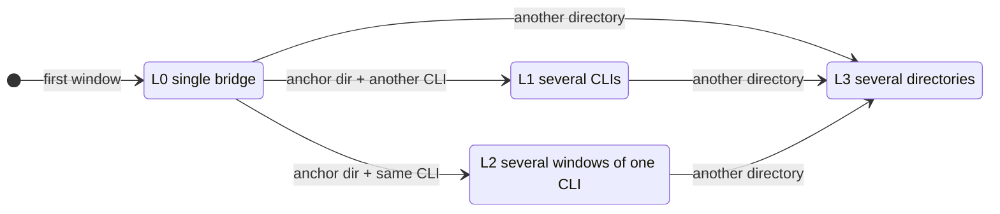

# CLI Chat Bridge

<p align="center">
  <a href="README.md">简体中文</a> · <strong>English</strong>
</p>

<p align='center'></p>

<p align="center"></p>

<p align="center">
  <a href="https://unlinearity.github.io/CLI-WeChat-Bridge/en/"></a>
  <a href="https://github.com/UNLINEARITY/CLI-WeChat-Bridge"></a>
  <a href="https://www.npmjs.com/package/cli-wechat-bridge"></a>
  <a href="https://www.npmjs.com/package/cli-wechat-bridge"></a>
  <a href="https://www.npmjs.com/package/@unlinearity/cli-wechat-bridge"></a>
  <a href="https://www.npmjs.com/package/cli-wechat-bridge">
  
</a>
  <a href="https://github.com/UNLINEARITY/CLI-WeChat-Bridge/actions/workflows/ci.yml"></a>
</p>

**Bridge WeChat, WeCom, and Telegram to your local AI CLI tools**: this project connects chat messages to locally running [`Codex`](https://github.com/openai/codex), [`Claude Code`](https://code.claude.com/docs/en/overview), [`OpenCode`](https://github.com/anomalyco/opencode), and [`Pi`](https://github.com/earendil-works/pi), and sends local output, approval requests, and runtime status back to the same channel.

The project is built around local workflows and preserves the **native terminal experience**. You keep using the original CLI and its advanced options locally, while WeChat, WeCom, or Telegram provides remote input, replies, and status updates.

<p align='center'></p>

## Documentation

- [Progressive bridge modes](docs/bridge-modes_EN.md): start with a clean single bridge and grow into L1 several CLIs, L2 several windows of one CLI, or L3 several directories as you open windows, with diagrams.
- [Telegram setup](#33-telegram-setup): create a bot, pair an operator, and launch a CLI.
- [Troubleshooting](docs/troubleshooting.md) (Chinese): context tokens, network proxies, local endpoints, and known limitations.
- [Codex channel connection skill (experimental)](docs/codex-connection.md#english): invoke the `$codex-bridge` skill inside Codex to connect your current Codex session (0.162+ shared daemon mode) to WeChat, WeCom, or Telegram.
- [Runtime configuration](docs/configuration.md) (Chinese): shared data directories, interface language, upload limits, and debug environment variables.
- [Development guide](docs/development.md) (Chinese): source execution, tests, builds, packaging, and global installation smoke checks.
- [Release notes](docs/releases/README.md): changes and upgrade instructions, with English and Chinese notes.
- [Communication architecture](docs/architecture.md) (Chinese): CLI adapter protocols, PTY/RPC dependencies, and design decisions.

## 1. What does this project solve?

This project fits workflows where:

- Most of your work happens in a local terminal.
- You want to keep using native Codex, Claude Code, OpenCode, or Pi sessions.
- You want to send requests and receive output and status through WeChat, WeCom, or Telegram while away from your computer.

The local CLI remains the primary workspace:

- Its native interface and behavior remain available.
- **WeChat, WeCom, or Telegram is the remote entry point** into that local session.
- Session consistency, thread state, and approvals stay centered on the **local session**.

### Progressive bridge modes

The bridge starts as a clean single bridge: with one CLI, replies carry no labels and the chat shows only single-CLI commands. It then grows with the windows you open on your computer: another CLI type in the same directory leads to L1 several CLIs, the same CLI again to L2 several windows of one CLI, and a window in another directory to L3 several directories; upgrades never step back down. See [Progressive bridge modes](docs/bridge-modes_EN.md) for each level's diagram, commands, and rules, and [section 6](#progressive-modes) for a quick reference.



## 2. Quick start

### 1. Requirements

- [Node.js](https://nodejs.org/en/download) `>= 22.13.0` (the official LTS release is recommended).
- Install at least one of these local CLIs and keep it up to date:
  - [Codex](https://github.com/openai/codex) (managed-client workflow validated with `0.149.x`–`0.161.x`; current-session attach requires the `0.162+` shared daemon).
  - [Claude Code](https://code.claude.com/docs/en/overview)
  - [OpenCode](https://github.com/anomalyco/opencode) (supports both `1.18.x` and `2.0.x`).
  - [Pi](https://github.com/earendil-works/pi) (connects through a native TUI extension; the `pi` command must be available locally).
- The bridge uses standalone CLI executables available in `PATH`. It does not discover private executables bundled inside desktop applications such as ChatGPT.app.
- Prepare a messaging channel: use `wechat-setup` for personal WeChat, `wecom-setup` for WeCom, or `telegram-setup` for Telegram.

### 2. Install and update

Install or update the published npm package:

```bash
npm install -g cli-wechat-bridge@latest
```

The legacy package name `@unlinearity/cli-wechat-bridge` continues to receive the same releases. Existing users can keep updating it; new users should prefer the shorter `cli-wechat-bridge` name.

Since 1.3.0 the same build is also published under the project's upcoming name, `cli-chat-bridge` (`npm install -g cli-chat-bridge@latest`). The three packages provide the same commands, so install only one; to switch names, `npm uninstall -g` the current package first, or npm stops with `EEXIST`.

<details>
<summary><b>Installation issues with the node-pty native module?</b></summary>

The project uses `node-pty` for terminal emulation. **Claude Code currently uses interactive PTY mode**; when node-pty is unavailable it falls back to a compatibility mode that may not bridge correctly. Codex primarily uses WebSocket RPC and is usually unaffected. OpenCode does not depend on node-pty. Pi inherits the visible companion's real terminal and also does not need PTY emulation.

**Recent npm versions may block installation scripts on Linux.** If npm reports that the `cli-wechat-bridge` or `node-pty` install/postinstall scripts are not permitted by `allowScripts`, reinstall with explicit script permissions:

```bash
npm uninstall -g cli-wechat-bridge
npm install -g cli-wechat-bridge@latest --allow-scripts=cli-wechat-bridge,node-pty
```

Include `cli-wechat-bridge@latest` in the same installation command. Running `npm install -g --allow-scripts=...` without a package name makes npm look for `package.json` in the current directory and may produce `ENOENT /home/<user>/package.json`.

To keep allowing these two scripts during future global upgrades, save the setting at user level:

```bash
npm config set allow-scripts=cli-wechat-bridge,node-pty --location=user
```

**Linux** (the most common case): install the native module build tools:

```bash
# Debian / Ubuntu
sudo apt install build-essential python3
# RHEL / Fedora
sudo dnf groupinstall "Development Tools" && sudo dnf install python3
# Alpine
apk add build-base python3
```

After installing the build tools, reinstall with the `--allow-scripts=cli-wechat-bridge,node-pty` command above.

**macOS**: if compilation fails, install the Xcode command line tools with `xcode-select --install`.

**Windows**:
- Requires Windows 10 1809 (build 18309) or newer.
- If node-pty fails to load, run `npm rebuild node-pty` or reinstall.
- Install the [Visual C++ Redistributable](https://aka.ms/vs/17/release/vc_redist.x64.exe).

Run `wechat-daemon --doctor` for a quick environment check. See [PTY fallback troubleshooting](docs/troubleshooting.md#pty-不可用--回退模式) (Chinese).


</details>

### 3. Configure your preferred channels

#### 3.1 WeChat login

After global installation, run:

```bash
wechat-setup
```

The QR code defaults to `small` mode. If the smaller QR characters render incorrectly in your Windows terminal, run:

```bash
wechat-setup --qr-mode normal
```

This selects the normal QR code mode.

The login flow:

1. Requests a WeChat login QR code.
2. Prints the QR code in your terminal.
3. Waits for you to scan it and confirm in WeChat.
4. Saves the credentials locally.

<p align="center">
  
</p>

After login, the bridge clears old sync cursors and context tokens to avoid carrying stale state into the new login. See [data directories, state files, and migration](docs/troubleshooting.md#数据目录与状态文件) (Chinese).

The four direct WeChat launchers also prompt for QR login in the foreground on first use or when the login expires.

#### 3.2 WeCom setup

WeCom uses the official smart-bot persistent connection and does not need a public callback URL:

1. In the WeCom client, create an API-mode bot under **Workbench → Smart Bot** (工作台 → 智能机器人), select the persistent connection option (使用长连接), and obtain the Bot ID and Secret.
2. Run `wecom-setup` and enter the Bot ID and Secret.
3. In a private chat with the bot, send the `/pair <code>` shown in your terminal to pair the operator.

<p align="center">
  
</p>

#### 3.3 Telegram setup

Telegram uses official [Bot API long polling](https://core.telegram.org/bots/api#getupdates), so no public callback URL is required. Your computer must be able to reach `api.telegram.org`. See the [source build instructions](docs/development.md#源码更新) (Chinese).

1. Open [@BotFather](https://t.me/BotFather) in Telegram, send `/newbot`, and follow the prompts to create a bot and obtain its Bot Token ([official instructions](https://core.telegram.org/bots/tutorial#obtain-your-bot-token)).
2. Run `telegram-setup` in your local terminal and enter the Bot Token.
3. Open a private chat with your new bot, click **Start**, and send `/pair <six-digit-code>` using the code shown in the terminal within 10 minutes. Use the Telegram account that will control the CLI.
4. When the terminal prints `Telegram operator pairing completed.`, setup is complete. Credentials and operator identity are saved in `~/.cli-bridge/telegram/account.json` and reused on subsequent launches.
5. Enter your project directory and run `telegram-daemon --adapter codex`, or choose a `telegram-*` direct launcher from the table below. Then send a task in the bot's private chat.

```bash
telegram-setup          # Configure the bot and pair its operator
telegram-setup --check  # Check the configured Bot Token
```

Run only one bridge or daemon per Bot Token at a time. Before pairing again with `telegram-setup`, stop any bridge already using that bot.

### 4. Send a sync message from WeChat first (WeChat only)

After starting the bridge, send a message to the bot in WeChat, such as `hello`, a task, or any short text. This gives the bridge a fresh WeChat `context_token` so local terminal input, final replies, and approvals can be sent back reliably.

If you start with local terminal input after a cold start or a long idle period, the CLI may still process it, but the reply to WeChat can fail because the old `context_token` has expired. You may see a local reply without a WeChat reply. Sending a fresh message from WeChat restores context for subsequent two-way synchronization.

### 5. Launch a local CLI directly

Enter the project directory you want to work in:

```bash
cd D:\work\your-project
```

Choose a launcher:

| Local CLI | WeChat command | WeCom command | Telegram command |
| --- | --- | --- | --- |
| Codex | `wechat-codex` | `wecom-codex` | `telegram-codex` |
| Claude Code | `wechat-claude` | `wecom-claude` | `telegram-claude` |
| OpenCode | `wechat-opencode` | `wecom-opencode` | `telegram-opencode` |
| Pi | `wechat-pi` | `wecom-pi` | `telegram-pi` |


A direct launcher runs the CLI in the current terminal and connects it to the bridge:

- Without a running daemon, it starts an ephemeral daemon in the background, and the bridge begins as an [L0 single bridge](docs/bridge-modes_EN.md#l0-single-bridge); the ephemeral daemon exits once all its windows close.
- With a running daemon, it joins it and the bridge grows by the [progressive bridge modes](docs/bridge-modes_EN.md): another CLI type in the same directory leads to L1, the same CLI again to L2, and another directory to L3.

To connect an **already running Codex session** to WeChat, WeCom, or Telegram instead of opening a new one, invoke the `$codex-bridge` skill inside that Codex session and name the channel. This requires Codex >= 0.162 in shared daemon mode; see the [Codex connection guide](docs/codex-connection.md#english).

### 6. Persistent daemon mode

To keep the messaging connection online and switch between Codex, Claude Code, OpenCode, and Pi, start a daemon in your project directory:

```bash
cd D:\work\your-project
wechat-daemon
```

WeCom uses the same daemon workflow:

```bash
wecom-daemon --adapter claude
```

For Telegram, use `telegram-daemon --adapter codex`. It supports the same CLI switching commands.

Send these commands in the connected channel to select the active terminal:

| Command | Behavior |
| --- | --- |
| `/codex [prompt]` | Switch to Codex; if a prompt is included, forward it immediately after switching |
| `/claude [prompt]` | Switch to Claude Code; if a prompt is included, forward it immediately after switching |
| `/opencode [prompt]` | Switch to OpenCode; if a prompt is included, forward it immediately after switching |
| `/pi [prompt]` | Switch to Pi; if a prompt is included, forward it immediately after switching |

After starting the daemon, you can switch CLIs from the messaging channel. When a CLI has no visible window, the daemon opens one or reuses an existing one.

<p align="center">
  
</p>

<p align="center">
  
</p>

<p align="center">
  
</p>

Daemon behavior:

- The bridge grows with the windows you open (see [Progressive bridge modes](docs/bridge-modes_EN.md)): with one CLI it is a clean single bridge, and the channel shows only single-CLI commands.
- One daemon can manage several working directories: running a direct launcher (for example `wechat-claude`) in another directory runs the CLI in that terminal and adds the directory to the running daemon. Send `/cd` in the channel to list directories and `/cd <number>` or `/cd <name>` to switch. Only directories opened on this computer can be selected.
- A single bridge sends output unlabeled; with several CLIs output is labeled like `[codex]`, with several windows of one CLI like `[pi-1]`, and across directories like `[directory/codex]`.
- Startup takes over and cleans up old standalone bridge processes, stale locks, and old endpoints.
- It opens a new visible terminal in the directory of the current window when the requested CLI is not already available, or in its startup directory while no window is open.
- Send `/daemon-stop` in the connected channel to stop the daemon.

#### Progressive modes

Quick reference below; see [Progressive bridge modes](docs/bridge-modes_EN.md) for the diagram, commands, and upgrade rules of each level.

| Mode | When it starts | Switching from the channel |
| --- | --- | --- |
| L0 single bridge | The first window | Not needed |
| L1 several CLIs | Another CLI type in the same directory (for example `wechat-pi`, then `wechat-opencode`) | `/pi`, `/opencode`, and so on |
| L2 several windows of one CLI | The same CLI again in the same directory (run `wechat-pi` again), or `/open` in a single bridge | `/1`, `/2`; `/open` opens another |
| L3 several directories | Any CLI in another directory | `/cd` for directories, `/codex` and the like for CLIs, `/1`, `/2` for windows of one CLI |

You can also select the initial CLI when starting it:

```bash
wechat-daemon --adapter codex
wechat-daemon --adapter claude --profile work
```

When a daemon for the channel is already running, direct launchers in any directory join it: the CLI runs in the current terminal and the daemon registers the window by the progressive modes, keeping the daemon and other CLI windows running.

## 3. Adapter support

> Local files can be sent to WeChat, WeCom, or Telegram, and files received from these channels can be passed to the local CLI for analysis. The selected model and CLI must support the file type.

<p align="center">
  
</p>

Images and ordinary files received through WeChat, WeCom, or Telegram are saved locally:

- The bridge adds local file paths to the prompt forwarded to Codex, Claude Code, OpenCode, or Pi, so the CLI can read or analyze them.
- The bridge does not perform OCR or extract PDF/DOCX text automatically. The local CLI handles parsing through those paths.
- Telegram attachments are saved under `~/.cli-bridge/telegram/inbound-attachments/`; videos, voice messages, and audio files are also supported. See [data directories and state files](docs/troubleshooting.md#数据目录与状态文件) (Chinese) for other channels.

| Adapter | Status | Notes |
| --- | --- | --- |
| `codex` | Supported | `wechat-codex` / `wecom-codex` / `telegram-codex` ensure the internal runtime and open a visible Codex client; the channel follows its local thread |
| `claude` | Supported | `wechat-claude` / `wecom-claude` / `telegram-claude` start or reuse Claude Code; sessions, final replies, and approvals follow Claude session semantics |
| `opencode` | Supported | `wechat-opencode` / `wecom-opencode` / `telegram-opencode` start or reuse OpenCode; local session following and remote `/new` / `/new-session` are supported |
| `pi` | Supported | `wechat-pi` / `wecom-pi` / `telegram-pi` launch the native Pi TUI and connect the messaging channel to the same session through a local extension; final replies, stopping, new sessions, and restoring are supported |

Pi runs with the local user's permissions. The bridge adds no tool approval layer and passes `--approve` to trust project configuration, extensions, and other local files; this flag is not a per-tool approval switch. File access and commands use the account that started the Pi launcher. Native themes, shortcuts, model selection, and extension UI remain available. `wechat-pi`, `wecom-pi`, and `telegram-pi` are themselves the native Pi TUI controlled through the channel; do not start a second Pi process writing to the same session file. Pi `0.85.0` and later require Node.js `>=22.19.0`; all three launchers check this before startup.

### Codex examples

<p align="center">
  
</p>

<p align="center">
  
</p>

### Claude Code examples

<p align="center">
  
</p>

<p align="center">
  
</p>

### OpenCode / Pi examples

In OpenCode mode, all three channels support `/new` or `/new-session`. A new session created in the local OpenCode CLI also becomes the session followed by the channel.

## 4. Terminal commands

Run commands from the target project directory. `wechat-*` selects personal WeChat, `wecom-*` selects WeCom, and `telegram-*` selects Telegram. The adapter names and options are shared across all three.

### 4.1 Global entry points

| Purpose | WeChat | WeCom | Telegram | Notes |
| --- | --- | --- | --- | --- |
| Login / pairing | `wechat-setup` | `wecom-setup` | `telegram-setup` | WeChat uses QR login; WeCom takes a Bot ID and Secret; Telegram takes a Bot Token. WeCom and Telegram require `/pair` |
| Persistent daemon | `wechat-daemon` | `wecom-daemon` | `telegram-daemon` | Keep a channel connection alive and manage multiple CLI slots in the current directory |
| Codex | `wechat-codex` | `wecom-codex` | `telegram-codex` | Start or reuse a visible Codex terminal |
| Claude Code | `wechat-claude` | `wecom-claude` | `telegram-claude` | Start or reuse a visible Claude Code terminal |
| OpenCode | `wechat-opencode` | `wecom-opencode` | `telegram-opencode` | Start or reuse a visible OpenCode terminal |
| Pi | `wechat-pi` | `wecom-pi` | `telegram-pi` | Start or reuse the native Pi TUI |

### 4.2 Persistent daemon

| Option | Purpose | Example |
| --- | --- | --- |
| `--cwd <path>` | Bind the daemon to a working directory | `wechat-daemon --cwd D:\work\my-project` |
| `--adapter <codex / claude / opencode / pi>` | Select the initial CLI | `wechat-daemon --adapter claude` |
| `--profile <name-or-path>` | Pass a profile to the adapter | `wechat-daemon --adapter claude --profile work` |
| `--no-open` | Create a runtime slot without opening a visible CLI | `wechat-daemon --no-open` |
| `--doctor` | Check Node.js, CLIs, locks, endpoints, and daemon state | `wechat-daemon --doctor` |

WeCom and Telegram daemons accept the same options, for example `wecom-daemon --adapter claude --profile work` or `telegram-daemon --adapter claude --profile work`. Launchers in other directories join the same daemon. The daemon's startup directory is its home: while no window is open, CLIs opened from the chat start there; afterwards they start in the directory of the current window. See the [channel commands](#5-channel-commands) below.

### 4.3 Direct adapter launchers

| Adapter | WeChat | WeCom | Telegram | Default session policy |
| --- | --- | --- | --- | --- |
| Codex | `wechat-codex` | `wecom-codex` | `telegram-codex` | New session |
| Claude Code | `wechat-claude` | `wecom-claude` | `telegram-claude` | New session |
| OpenCode | `wechat-opencode` | `wecom-opencode` | `telegram-opencode` | New session |
| Pi | `wechat-pi` | `wecom-pi` | `telegram-pi` | New session |

Shared options:

| Option | Purpose | Example |
| --- | --- | --- |
| `--cwd <path>` | Set the runtime and visible CLI working directory | `wechat-claude --cwd D:\work\my-project` |
| `--profile <name-or-path>` | Pass a profile to the internal runtime | `wechat-claude --profile work` |
| `--timeout-ms <ms>` | How long to wait for the background daemon to start, default `15000` ms; it waits at least 20 seconds | `wechat-codex --timeout-ms 30000` |
| `--session-start-mode <restore / new>` | Explicitly restore a session or create a new one | `wechat-pi --session-start-mode restore` |
| `--doctor` | Check the selected adapter and workspace without starting a CLI | `wechat-claude --doctor` |
| Other arguments | Forward to the underlying visible CLI | `wechat-codex --model gpt-5.2 --yolo` |

`--yolo` is forwarded to Codex; `--dangerously-skip-permissions` is forwarded to Claude Code. These options affect the visible CLI without overriding internal runtime settings or channel credentials. Change the command prefix to `wecom-` or `telegram-` for the other channels.

### 4.4 Updates

| Action | Command | Notes |
| --- | --- | --- |
| Check for updates | `wechat-check-update` / `wecom-check-update` / `telegram-check-update` | Query the latest npm version |
| Upgrade | `npm install -g cli-wechat-bridge@latest` | Restart running daemons and visible CLI windows after upgrading |

Direct launchers also accept `--doctor` to check the selected adapter and current workspace without starting the CLI.

## 5. Channel commands

These commands work with WeChat, WeCom, and Telegram. Ordinary text is sent to the active session. Adapter switching commands with `[prompt]` first select the CLI, then forward the prompt.

### 5.1 Shared controls

| Command | Scope | Behavior |
| --- | --- | --- |
| Ordinary text | Direct launch, daemon | Send to the active session |
| `/codex [prompt]` | Daemon | Switch to Codex and optionally forward a prompt |
| `/claude [prompt]` | Daemon | Switch to Claude Code and optionally forward a prompt |
| `/opencode [prompt]` | Daemon | Switch to OpenCode and optionally forward a prompt |
| `/pi [prompt]` | Daemon | Switch to Pi and optionally forward a prompt |
| `/cd`, `/cd <number or name>` | Daemon (several directories) | List the working directories the daemon manages, or switch the current one; only directories opened on this computer can be selected |
| `/all <prompt>` | Daemon (several CLIs, several windows, several directories) | Send the same prompt to every started window in the current directory; unstarted CLIs are skipped, and the whole dispatch is canceled if any window is busy |
| `/open` | Daemon (single bridge, several windows, several directories) | Open another window of the current CLI in the current directory |
| `/1`, `/2`, … (optional prompt) | Daemon (several windows, several directories) | Switch to that numbered window of the current CLI; an optional prompt is forwarded after the switch |
| `/status` | Direct launch, daemon | Show bridge, daemon, adapter, and workspace state |
| `/lang`, `/lang zh`, `/lang en` | Direct launch, daemon | View or switch Chinese/English bridge messages; applies immediately and saves the preference. `/language` is an alias |
| `/model`, `/model <number>` | Codex, Claude Code, OpenCode, Pi | List and switch models for the current session; numbered lists expire after 5 minutes |
| `/plan`, `/plan on`, `/plan off` | Codex, Claude Code, OpenCode | Enable plan mode or restore the previous mode / primary agent |
| `/stop` | Direct launch, daemon | Interrupt the current task |
| `/reset` | Direct launch, daemon | Rebuild the local session |
| `/new`, `/new-session` | OpenCode, Pi | Create a new session |
| `/resume`, `/resume <number or ID prefix>` | Codex, Claude Code, OpenCode, Pi | List and restore recent threads/sessions in the current directory; numbered lists expire after 5 minutes |
| `/confirm`, `/yes` | Direct launch, daemon | Approve the current pending permission request; when only other terminals or directories have one, reply with a numbered list |
| `/confirm <number>`, `/deny <number>` | Daemon | Resolve the approval with that number in the list |
| `/deny`, `/no` | Direct launch, daemon | Reject the current pending permission request |
| `confirm`, `yes` | Pending approval | Text aliases for `/confirm` |
| `deny`, `no` | Pending approval | Text aliases for `/deny` |
| `/auto`, `/auto on`, `/auto off` | Direct launch, daemon | View, enable, or disable auto-approval for every window; the default returns when the daemon restarts |
| `/answer <key>=<value>` | Pending question | Submit structured answers for Codex, Claude Code, or OpenCode |
| `/answer`, `/answer #<number> <answer>` | Daemon | List every waiting question, or answer the one with that number |
| `/daemon-stop` | Daemon | Stop the persistent daemon |
| `/pair <code>` | WeCom / Telegram setup | Pair the operator after `wecom-setup` or `telegram-setup` prompts you |

Send `/lang en` in the connected chat for English bridge messages, or `/lang zh` for Chinese. For startup environment-variable precedence, see [interface language](docs/configuration.md#界面语言) (Chinese).

- **Answering questions:** Claude's `AskUserQuestion` forwards questions, option descriptions, and text previews. For one question, reply with `/answer 1` or custom text; for several, answer all at once, for example `/answer 1=Yes;2=2;3=1,2;4=1` (separate multiple selections with commas). When the hook times out or disconnects, the remote question is cleared; answer in the local terminal or use `/stop`.
- **Approvals:** each `/confirm` or `/deny` resolves only the currently displayed request, then shows the next one and says how many are still waiting; requests resolved in the local terminal are removed remotely too. See [troubleshooting](docs/troubleshooting.md#审批与权限请求) (Chinese) for what is approved automatically; the final reply lists what was approved automatically in that turn.
- **Models and plan mode:** Claude Code's `/model` and `/plan` need the visible CLI at an idle native prompt with no pending approval, local draft, or popup; local keyboard input during the operation cancels it. OpenCode's `/plan off` falls back to `build` when there is no history; Pi's `/plan` is defined by optional extensions, not by the bridge. Model lists are bound to the session, CLI process, and operator; send `/model` again after changing the session or active CLI.
- **Web access:** Claude Code allows ordinary web requests by default (`WebFetch(domain:*)`); set `CLI_BRIDGE_STRICT_APPROVAL=1` to turn this off. See [runtime configuration](docs/configuration.md) (Chinese).

See the [communication architecture](docs/architecture.md) (Chinese) for how each adapter implements these controls.

### Typing indicators and reply delivery

Tasks dispatched from WeChat show its native typing indicator, refreshed every 5 seconds until delivery, task failure, or daemon shutdown. Typing credentials are fetched per recipient from the official WeChat configuration endpoint and refreshed automatically. If fetching fails, typing indicators are silently disabled without affecting messages.

Long WeChat replies are sent as a complete message rather than split at a fixed length. If the server rejects an oversized reply, the existing retry and pending-message mechanisms record the failure so it is not silently lost.

Telegram tasks also keep the native typing indicator active, and long replies are split to fit Telegram's message length limits.

### Daemon IPC for external integrations

`wechat-daemon`, `wecom-daemon`, and `telegram-daemon` expose a local IPC interface with token authentication. External applications such as web panels, scripts, or custom bot frontends can dispatch input using the same rules as chat messages or send through the channel. Busy dispatches are rejected, pending approvals and questions pause dispatch, and input during a local Codex task is queued automatically. Replies retain their conversation target, and rejected or failed input rolls back state. See [development documentation](docs/development.md) (Chinese) for the interface.

### 5.2 Session restoration and local synchronization

| Adapter | Remote `/resume` | Local synchronization |
| --- | --- | --- |
| Codex | List CLI / VS Code root threads in the current directory, preflight with `thread/read` and `thread/resume`, then commit the shared thread once the visible client is stable | Codex picker or local `/resume` thread changes are synchronized to the channel |
| Claude Code | Submit an exact `/resume <UUID>` to the current PTY and wait for `SessionEnd(reason=resume)` and target `SessionStart(source=resume)` | Local picker or `/resume` changes produce the same hook sequence; the channel follows the new transcript |
| OpenCode | List sessions in the current directory and restore the selected session | Local picker, `/resume`, or a new session updates the session followed by the channel |
| Pi | List sessions in the current directory and restore the selected session | Local session changes are followed; each completed Pi turn sends one final reply |

All adapters' `/resume` commands operate on recent root threads/sessions in the current directory (in the daemon, the one selected with `/cd`) and wait for the current task to become idle. Resolve active tasks, approvals, or questions first, or use `/stop`. Active Codex threads and running Claude background sessions cannot be taken over remotely. Local OpenCode and Pi session changes invalidate earlier numbered lists. If a local switch happens during a remote task, the bridge interrupts the old task first.

### 5.3 Daemon emoji bindings

Daemon mode maps emoji tokens at the start of a message to commands. All three channels share the configuration, saved in `~/.cli-bridge/emoji-bindings.json`; edits apply immediately.

The Chinese tokens below are literal bindings. Type them as shown, or customize them with `/bind`.

<p align="center">
  
</p>

| Emoji token | Default command | Behavior |
| --- | --- | --- |
| `[OK]` | `/confirm` | Approve a permission request |
| `[闭嘴]` | `/stop` | Interrupt the current task |
| `[拥抱]` | `/claude` | Switch to Claude Code |
| `[强]` | `/codex` | Switch to Codex |
| `[胜利]` | `/opencode` | Switch to OpenCode |
| `[再见]` | `/daemon-stop` | Stop the daemon |

| Management command | Behavior |
| --- | --- |
| `/bindings` | Show all bindings |
| `/bind [emoji] /command` | Bind an emoji token, for example `/bind [微笑] /status` |
| `/unbind [emoji]` | Remove a binding, for example `/unbind [微笑]` |

Tokens must appear at the start of the message to trigger a binding. Text after the token is forwarded after the command executes. Matching is case insensitive.

## 6. Acknowledgments and license

### Thank you

> Thanks to everyone who reports issues or contributes pull requests.

If this project helps you, you can support its development by buying the author a milk tea. ❤️

<p align='center'></p>

### Related links

<p align="center">
  <a href="https://atomgit.com/UNLINEARITY/CLI-WeChat-Bridge"></a><br>
  This project is also hosted on AtomGit.
</p>


Main dependencies:

- [@opencode-ai/sdk](https://www.npmjs.com/package/@opencode-ai/sdk): OpenCode session and event stream client.
- [@wecom/aibot-node-sdk](https://www.npmjs.com/package/@wecom/aibot-node-sdk): WeCom smart-bot WebSocket client.
- [@modelcontextprotocol/sdk](https://github.com/modelcontextprotocol/typescript-sdk): TypeScript SDK used by the MCP server entry point.
- [node-pty](https://github.com/microsoft/node-pty): local PTY / ConPTY process bridge.
- [qrcode-terminal](https://github.com/gtanner/qrcode-terminal): terminal QR code rendering.

Runtime and development tools:

- [Node.js](https://nodejs.org/): published packages and CLI entry points.
- [TypeScript](https://www.typescriptlang.org/): source language and build tooling.
- [Bun](https://bun.sh/): source execution and tests.
- [ESLint](https://eslint.org/): code checks.

Community and references:

- [Linux DO](https://linux.do/): an AI and technology community.
- [@tencent-weixin/openclaw-weixin](https://www.npmjs.com/package/@tencent-weixin/openclaw-weixin): the OpenClaw Weixin channel npm package published by Tencent's WeChat team.
- [openclaw-weixin](https://github.com/hao-ji-xing/openclaw-weixin): an early WeChat / Claude Code Channel reference project.

### License

This project is **dual licensed**:

**Open source: [AGPL-3.0-or-later](LICENSE.txt)**

- Free for personal use, study, and research.
- Modifications and derivative works must be released under AGPL-3.0-or-later and retain the copyright notices.
- If you provide a service based on this project over a network, including internal or private deployments, you must offer users the complete corresponding source code (AGPL section 13).
- **Whether changes are made by people or AI tools**, distributing a modified version or providing it as a network service requires releasing the complete corresponding source under AGPL-3.0-or-later. Private use without distribution carries no such obligation.
- Source-file SPDX notices are part of the license notices and must not be removed or altered.

**Commercial licensing**

If you want to use this project in a closed-source commercial product without disclosing your source code, you need a commercial license. Contact the author to discuss licensing:

- GitHub: [@UNLINEARITY](https://github.com/UNLINEARITY)

<!-- star-history:start -->
<p align="center">
  <a href="https://star-history.com/#UNLINEARITY/CLI-WeChat-Bridge&amp;Date"></a>
</p>
<!-- star-history:end -->
