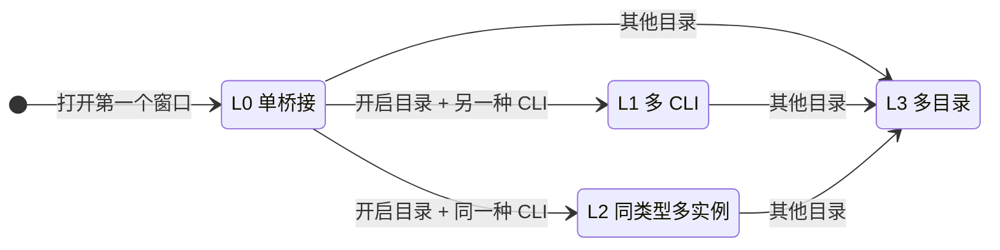
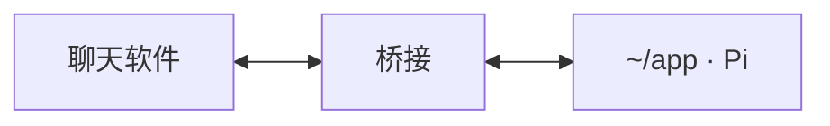
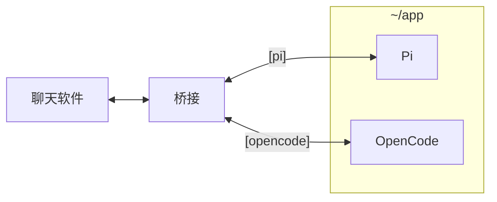
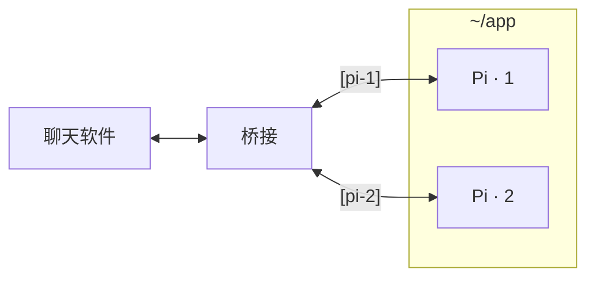
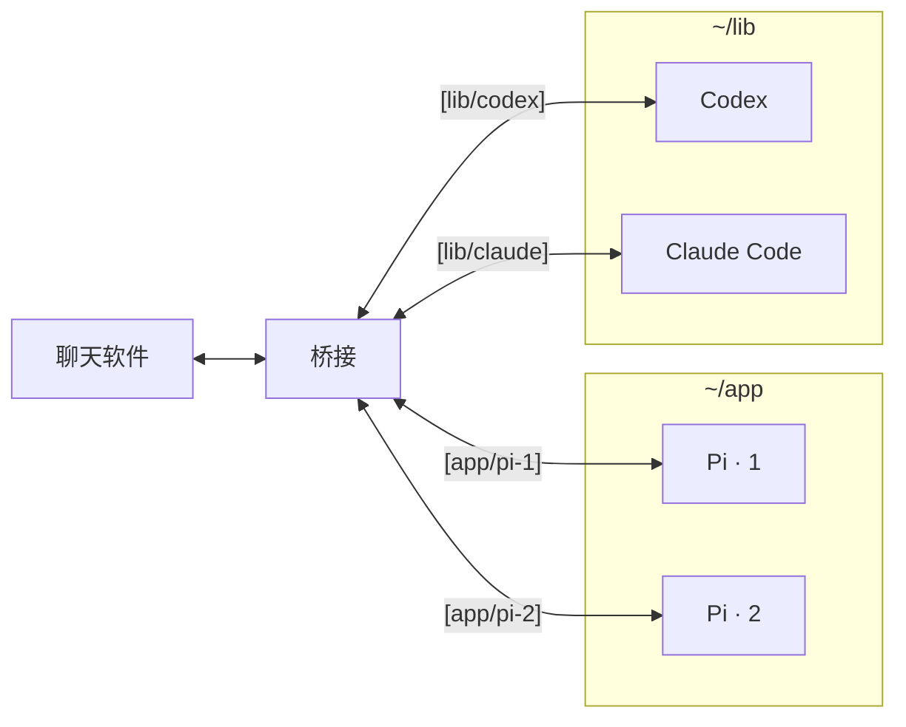

# 渐进桥接模式

<strong>简体中文</strong> · <a href="bridge-modes_EN.md">English</a>

桥接不是一开始就把所有能力摆出来，而是**随你在本机打开的窗口逐级扩展**。一共四级：L0 单桥接、L1 多 CLI、L2 同类型多实例、L3 多目录。你不需要选择模式，也不需要修改配置；打开窗口这个动作本身就决定了桥接处于哪一级。

几个术语先说明：

- **窗口**：在本机终端里运行的一个 CLI，例如在 `~/app` 中运行 `wechat-pi` 打开的 Pi。
- **开启目录**：第一个窗口所在的项目目录。L1、L2 都只发生在开启目录里。
- **升级**：打开新窗口后桥接进入更高一级。每次升级都会在聊天软件里收到一条通知，说明新开放了哪些命令。

从图里可以看出三条规则：L1 和 L2 是从 L0 出发的两个方向，彼此不能互相转换；任何一级只要在其他目录打开窗口，就会进入 L3；所有箭头都只向上，没有降级。

## L0 单桥接

**什么时候**：打开第一个窗口时。例如在 `~/app` 中运行 `wechat-pi`。

这是大多数人日常使用的状态：一个项目、一种 CLI。聊天软件里发的普通消息直接交给 Pi，Pi 的回复原样发回，**不带任何标签**。欢迎语只列出单 CLI 命令（`/stop`、`/status`、`/model`、`/plan`、`/resume`、`/new`、`/confirm`、`/deny`、`/answer`、`/lang`），不会出现 `/cd`、`/all` 或其他 CLI 的名字。

L0 中有两种方式升级：在本机同一目录运行另一个启动命令，或者在聊天软件里发送 `/open`（再开一个同类型窗口，进入 L2）、`/codex` 等（在当前目录打开另一种 CLI，进入 L1）。

## L1 多 CLI

**什么时候**：在开启目录里再打开**另一种** CLI。例如在 `~/app` 中先运行 `wechat-pi`，再运行 `wechat-opencode`。

不同的 CLI 各有所长，L1 让你在聊天软件里随时选择由谁处理下一条消息：

| 聊天指令 | 作用 |
| --- | --- |
| `/pi`、`/opencode`、`/codex`、`/claude` | 切换到对应 CLI；当前目录还没有它时，在本机打开一个新窗口 |
| `/opencode 修复失败的测试` | 切换后立即把后面的内容发给 OpenCode |
| `/all <prompt>` | 把同一段提示词同时发给所有 CLI |

回复带 `[pi]`、`[opencode]` 这类标签，用来区分来源。L1 中每种 CLI 在开启目录里只有一个窗口：再开第二个 Pi 会被拒绝，因为在 L1 里 `/pi` 的含义是"切换到 Pi"，两个 Pi 无法用它区分。

## L2 同类型多实例

**什么时候**：在开启目录里再打开**同一种** CLI。例如在 `~/app` 中运行两次 `wechat-pi`，或在 L0 中从聊天软件发送 `/open`。

适合让同一个 CLI 并行处理几件事，例如一个窗口写功能、另一个窗口跑测试和排错。窗口按编号区分：

| 聊天指令 | 作用 |
| --- | --- |
| `/1`、`/2` | 切换到对应编号的窗口 |
| `/2 跑一下集成测试` | 切换后立即把后面的内容发给 2 号窗口 |
| `/open` | 在当前目录再开一个同类型窗口，使用最小的空闲编号 |
| `/pi` | 切换到最近使用的那个 Pi 窗口 |
| `/all <prompt>` | 把同一段提示词同时发给所有窗口 |

回复带 `[pi-1]`、`[pi-2]` 标签。`/stop`、`/model`、`/resume` 等命令作用于当前选中的窗口。编号关闭后会空出来：`pi-2` 关闭后 `pi-1`、`pi-3` 的编号不变，下一个新窗口使用 2。L2 中开启目录只能有这一种 CLI，打开其他 CLI 会被拒绝。

## L3 多目录

**什么时候**：在 L0、L1、L2 中的任意一级，在**其他目录**打开任意 CLI。例如在 `~/app` 用着 Pi 时，又在 `~/lib` 中运行 `wechat-codex`。

L3 是完整的管理模式，**不再有任何限制**：任意目录、任意 CLI、任意数量的窗口都可以接入，按"目录 / CLI / 编号"三级寻址。之前在 L1 或 L2 中打开的窗口保持原样。

| 聊天指令 | 作用 |
| --- | --- |
| `/cd` | 列出所有目录及其中的窗口 |
| `/cd 2`、`/cd lib` | 按编号或目录名切换当前目录 |
| `/codex`、`/claude` 等 | 在当前目录中切换 CLI；没有时在当前目录打开 |
| `/1`、`/2`、`/open` | 在当前目录、当前 CLI 的多个窗口之间切换或新开 |
| `/all <prompt>` | 只发给**当前目录**的所有窗口，避免误发到其他项目 |

回复带 `[目录/CLI]` 标签，同一目录同一 CLI 有多个窗口时带编号，如 `[app/pi-2]`。审批和问题如果在其他目录等待，可以用 `/confirm <编号>`、`/answer #<编号>` 直接处理，无需先切过去。

## 升级规则

**L1 与 L2 互斥。** 在开启目录中，L1 的 `/pi` 表示"切换到 Pi"，L2 的每个窗口都是 Pi、只能靠编号区分。两种寻址方式混在一起，同一条命令就会有两种含义。因此：

| 当前 | 在开启目录中的操作 | 结果 |
| --- | --- | --- |
| L1 | 再开一种已有的 CLI | 拒绝；终端提示改到其他目录运行（进入 L3） |
| L2 | 打开另一种 CLI | 拒绝；终端提示改到其他目录运行，或先关闭这些窗口 |
| 任意 | 在其他目录打开 | 允许，进入 L3 |

**只升不降。** 关闭窗口不会让桥接退回低一级，你在聊天软件里看到的命令集和标签格式不会来回变化。L2 中只剩一个窗口时，回复仍然带 `[pi-1]`。

**生命周期决定何时重新开始。**

- 直接启动命令（`wechat-pi` 等）在没有运行中的 daemon 时会拉起一个临时 daemon。最后一个窗口关闭后它自动退出，下次启动重新从 L0 开始。
- `wechat-daemon` 只是一个常驻服务，本身不决定模式：启动后还没有窗口，第一个窗口进入 L0。所有窗口关闭后它回到初始状态，这时在聊天软件里发送 `/codex` 等命令，会在 daemon 的启动目录打开新的 CLI。已有临时 daemon 时运行 `wechat-daemon`，会把它转为常驻并保留当前级别。

**远程打开的窗口在哪个目录。** 从聊天软件打开新窗口（`/codex`、`/open` 等）时，使用当前选中窗口所在的目录；还没有窗口时，使用 daemon 的启动目录。

**附加的 Codex 会话也算一个窗口。** 通过 `$codex-bridge` skill 接入的 Codex 会话遵守同样的规则：旁边只有一个 Codex 窗口时成为 `codex-2`（L2），旁边是其他 CLI 时进入 L1，在其他目录附加时进入 L3。

当前级别可以在聊天软件里发送 `/status` 查看（"模式"一行）。被拒绝或命令不可用时的提示含义见[问题排查](troubleshooting.md#启动器被拒绝或远程命令提示当前模式下不可用)。
