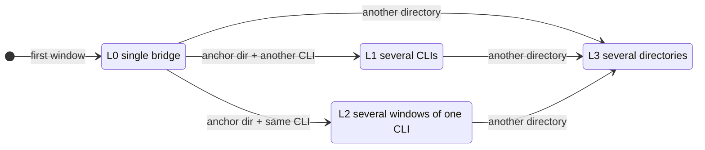
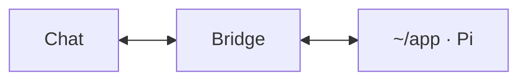
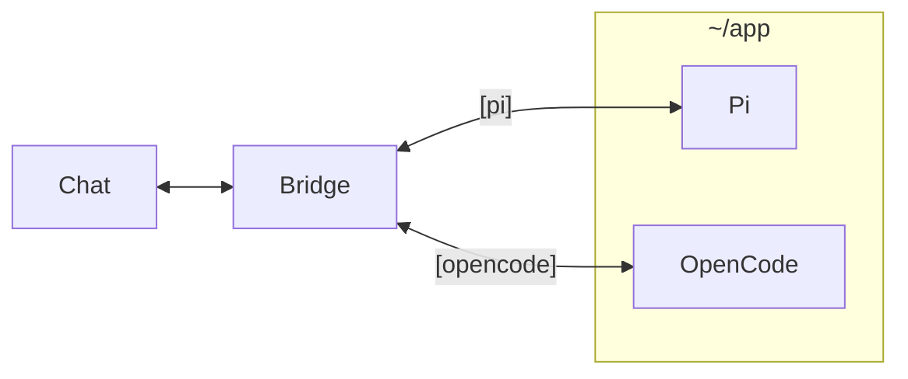
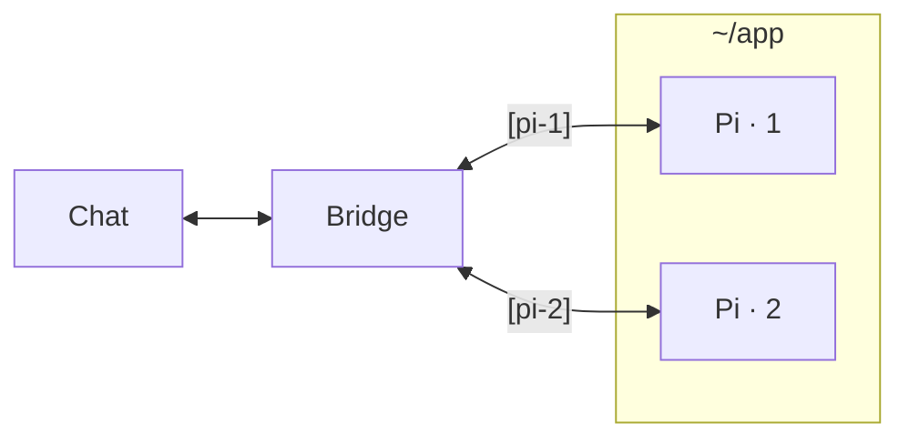
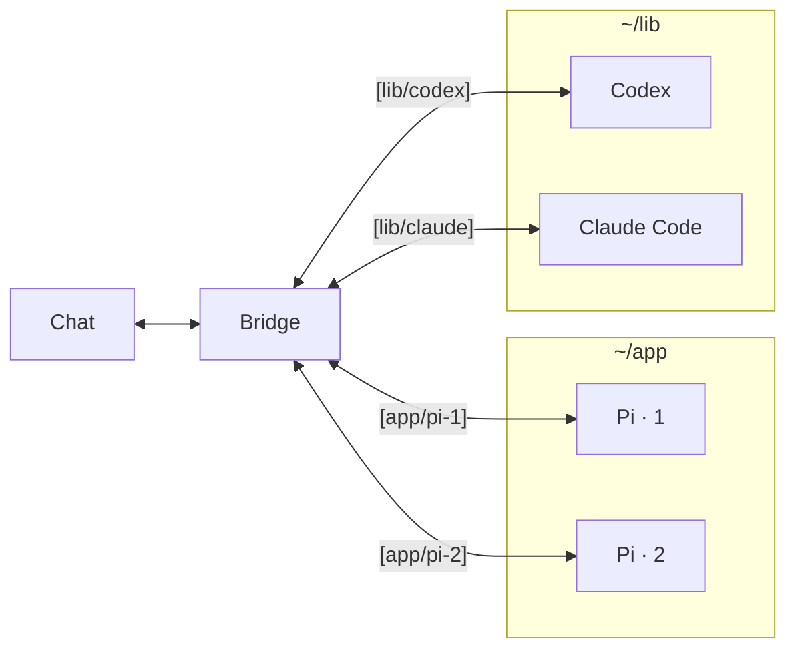

# Progressive bridge modes

<a href="bridge-modes.md">简体中文</a> · <strong>English</strong>

The bridge does not show every capability up front. It **grows with the windows you open on your computer**, through four levels: L0 single bridge, L1 several CLIs, L2 several windows of one CLI, and L3 several directories. There is no mode to choose and nothing to configure; opening a window is what moves the bridge to the next level.

A few terms first:

- **Window**: one CLI running in a local terminal, for example the Pi that `wechat-pi` opens in `~/app`.
- **Anchor directory**: the project directory of the first window. L1 and L2 happen only there.
- **Upgrade**: opening a window that moves the bridge up a level. Every upgrade sends a notice to the chat listing the commands it opened up.

The diagram shows three rules: L1 and L2 are two directions out of L0 and never turn into each other; any level moves to L3 once a window opens in another directory; every arrow points up, so there is no step down.

## L0 single bridge

**When**: the first window opens, for example `wechat-pi` in `~/app`.

This is the everyday state for most people: one project, one CLI. Plain messages go straight to Pi and its replies come back **without any label**. The welcome message lists only single-CLI commands (`/stop`, `/status`, `/model`, `/plan`, `/resume`, `/new`, `/confirm`, `/deny`, `/answer`, `/lang`); `/cd`, `/all`, and other CLI names do not appear.

L0 upgrades when you run another launcher in the same directory, or from the chat: `/open` opens another window of the same CLI (L2), and `/codex` and the like open another CLI in the current directory (L1).

## L1 several CLIs

**When**: **another** CLI type opens in the anchor directory, for example `wechat-pi` and then `wechat-opencode` in `~/app`.

Each CLI has its strengths, and L1 lets you pick from the chat which one handles the next message:

| Chat command | Effect |
| --- | --- |
| `/pi`, `/opencode`, `/codex`, `/claude` | Switch to that CLI; if the current directory does not have it yet, open a new window on your computer |
| `/opencode fix the failing test` | Switch, then send the rest of the message to OpenCode |
| `/all <prompt>` | Send one prompt to every CLI |

Replies are labeled `[pi]`, `[opencode]`, and so on. In L1 each CLI has one window in the anchor directory: a second Pi is refused, because in L1 `/pi` means "switch to Pi" and could not tell two Pis apart.

## L2 several windows of one CLI

**When**: the **same** CLI opens again in the anchor directory, for example `wechat-pi` twice in `~/app`, or `/open` sent from the chat in L0.

Useful for running several tasks in parallel on one CLI, such as building a feature in one window while another runs and fixes tests. Windows are told apart by number:

| Chat command | Effect |
| --- | --- |
| `/1`, `/2` | Switch to that numbered window |
| `/2 run the integration tests` | Switch, then send the rest of the message to window 2 |
| `/open` | Open another window of the same CLI in the current directory, with the lowest free number |
| `/pi` | Switch to the Pi window used most recently |
| `/all <prompt>` | Send one prompt to every window |

Replies are labeled `[pi-1]`, `[pi-2]`. Commands such as `/stop`, `/model`, and `/resume` act on the selected window. Closed numbers are freed: when `pi-2` closes, `pi-1` and `pi-3` keep their numbers and the next new window takes 2. In L2 the anchor directory runs only this CLI; opening another CLI there is refused.

## L3 several directories

**When**: from L0, L1, or L2, any CLI opens in **another directory**, for example `wechat-codex` in `~/lib` while you work with Pi in `~/app`.

L3 is the full management mode with **no restrictions**: any directory, any CLI, any number of windows, addressed by directory, CLI, and number. Windows opened in L1 or L2 stay as they are.

| Chat command | Effect |
| --- | --- |
| `/cd` | List every directory and its windows |
| `/cd 2`, `/cd lib` | Switch the current directory by number or name |
| `/codex`, `/claude`, and so on | Switch CLI within the current directory, opening it there if needed |
| `/1`, `/2`, `/open` | Switch between or open windows of the current CLI in the current directory |
| `/all <prompt>` | Send to every window of the **current directory** only, so a prompt never lands in another project |

Replies are labeled `[directory/CLI]`, with a number when one directory runs a CLI more than once, as in `[app/pi-2]`. Approvals and questions waiting in another directory can be handled with `/confirm <number>` and `/answer #<number>` without switching there first.

## Upgrade rules

**L1 and L2 exclude each other.** In the anchor directory, L1's `/pi` means "switch to Pi", while in L2 every window is Pi and only a number tells them apart. Mixing the two would give one command two meanings. So:

| Current | Action in the anchor directory | Result |
| --- | --- | --- |
| L1 | Open a CLI the directory already has | Refused; the terminal suggests running it in another directory (L3) |
| L2 | Open another CLI type | Refused; the terminal suggests another directory, or closing those windows first |
| Any | Open a window in another directory | Allowed; moves to L3 |

**One-way upgrades.** Closing windows never steps the bridge down, so the commands and labels you see in the chat do not keep changing. With one window left in L2, replies still read `[pi-1]`.

**The lifecycle decides when to start over.**

- A direct launcher (`wechat-pi` and the like) starts an ephemeral daemon when none is running. It exits once its last window closes, and the next launch starts at L0 again.
- `wechat-daemon` is just a resident service and does not choose a level: it starts with no window, and the first window enters L0. Once every window closes it starts over, and sending `/codex` or the like from the chat opens a CLI in its startup directory. Running `wechat-daemon` while an ephemeral daemon is up makes that daemon resident and keeps its level.

**Where remote windows open.** A window opened from the chat (`/codex`, `/open`, and so on) uses the directory of the selected window, or the daemon's startup directory while no window is open.

**An attached Codex session counts as a window.** A session joined through the `$codex-bridge` skill follows the same rules: next to a single Codex window it becomes `codex-2` (L2), next to another CLI the bridge enters L1, and in another directory it enters L3.

Send `/status` from the chat to see the current level (the "Mode" line). The [troubleshooting guide](troubleshooting.md) (Chinese) explains refusal and "not available in this mode" messages.
