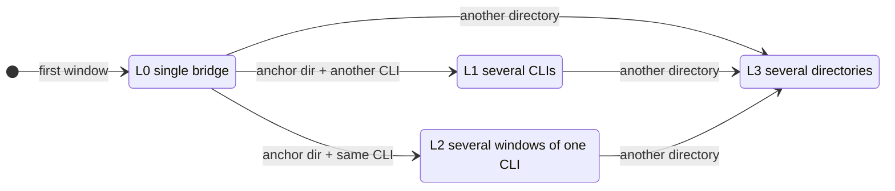
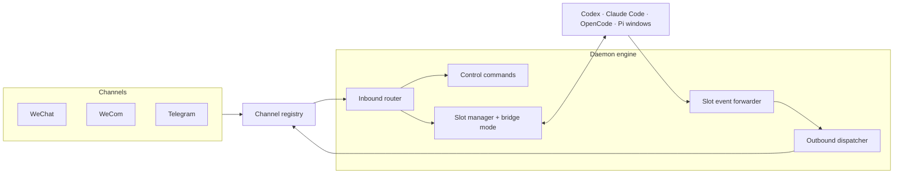

# Version 1.3.0

**Release Date:** October 20, 2026

## Overview

Version 1.3.0 is the largest release of CLI WeChat Bridge so far, and it has two parts that build on each other.

**A rebuilt core.** Until 1.2.3, two orchestration engines ran side by side: a standalone bridge behind the direct launchers and a separate daemon for multi-CLI use. Each implemented routing, approvals, and replies on its own, so behavior could drift between them. In 1.3.0 every launcher, every daemon, and Codex attach run on **one daemon engine**, which was split into focused modules and given a channel-neutral core. The rebuild touches 121 files, yet the source shrinks from 40,737 to 39,881 lines while gaining multi-directory, multi-window, and mode support. About 14,800 source lines changed (6,961 added, 7,817 removed); no earlier release exceeded 3,000.

**Progressive bridge modes.** On top of that engine, the bridge now grows with the windows you open. It starts as a clean single bridge, with no reply labels and only single-CLI commands, and moves up through four levels: several CLIs in one directory, several windows of one CLI, or several directories. Each upgrade is announced, and none is ever undone while the bridge runs.

The release is also published under a third package name, `cli-chat-bridge`, the project's upcoming channel-neutral name.

## Progressive Bridge Modes

Most people use one CLI in one project, and showing them `/cd`, `/all`, and four CLI names from the first message only gets in the way. Progressive modes reveal multi-bridge capability only when you ask for it by opening another window on your computer. There is no mode to choose and nothing to configure.



The **anchor directory** is the directory of the first window. L1 and L2 happen only there; a window anywhere else leads to L3.

### L0 Single Bridge

The first window, for example `wechat-pi` in `~/app`. Messages go straight to Pi and replies come back **without labels**. The welcome lists only single-CLI commands (`/stop`, `/status`, `/model`, `/plan`, `/resume`, `/new`, `/confirm`, `/deny`, `/answer`, `/lang`). From the chat, `/open` opens a second window of the same CLI (L2), and `/codex` and the like open another CLI in the current directory (L1).

### L1 Several CLIs

Another CLI type in the anchor directory, for example `wechat-opencode` next to Pi. Pick who handles the next message:

| Command | Effect |
| --- | --- |
| `/pi`, `/opencode`, `/codex`, `/claude` | Switch CLI; open it in the current directory if it is not running |
| `/opencode fix the failing test` | Switch, then send the rest to OpenCode |
| `/all <prompt>` | Send one prompt to every CLI; canceled as a whole if any is busy |

Replies carry `[pi]`, `[opencode]`. Each CLI has one window here, because `/pi` means "switch to Pi" and could not tell two Pis apart.

### L2 Several Windows of One CLI

The same CLI again in the anchor directory (`wechat-pi` twice, or `/open`), for parallel work on one CLI: a feature in one window, tests in another.

| Command | Effect |
| --- | --- |
| `/1`, `/2` | Switch to that numbered window |
| `/2 run the integration tests` | Switch, then send the rest to window 2 |
| `/open` | Open another window, taking the lowest free number |
| `/pi` | Switch to the Pi window used most recently |
| `/all <prompt>` | Send one prompt to every window |

Replies carry `[pi-1]`, `[pi-2]`. Numbers count per directory and CLI; when `pi-2` closes, `pi-1` and `pi-3` keep theirs and the next window takes 2. `/stop`, `/model`, `/resume`, and similar commands act on the selected window. Each numbered window has its own endpoint (`pi-2-companion-endpoint.json`) and session file (`slot-session-pi-2.json`); window 1 keeps the original names, so existing state stays valid.

### L3 Several Directories

Any CLI in another directory, from any level. L3 is the full management mode with no restrictions, addressed by directory, CLI, and number:

| Command | Effect |
| --- | --- |
| `/cd`, `/cd 2`, `/cd lib` | List directories and their windows; switch by number or name |
| `/codex`, `/claude`, ... | Switch CLI within the current directory, opening it there if needed |
| `/1`, `/2`, `/open` | Switch between or open windows of the current CLI |
| `/all <prompt>` | Send to the **current directory** only, so a prompt never lands in another project |

Replies carry `[directory/cli]`, with a number when a directory runs a CLI more than once (`[app/pi-2]`). Approvals and questions waiting in other windows are listed by `/confirm`, `/deny`, and `/answer`, and handled with `/confirm <number>` or `/answer #<number>` without switching.

### Rules That Keep It Predictable

- **L1 and L2 exclude each other in a directory.** Mixing them would make `/pi` mean both "switch to Pi" and "one of several Pis". A refused launcher explains why in the terminal and suggests another directory (L3), or closing the windows first.
- **One-way.** Closing windows never steps down, so the commands and labels in the chat stay stable. With one window left in L2, replies still read `[pi-1]`.
- **Every upgrade is announced** with its own notice listing what it opened up; the three notices read differently.
- **Remote opens follow the selected window:** `/codex`, `/open`, and the like start the CLI in the directory of the selected window, or in the daemon's startup directory while no window is open.
- **An attached Codex session counts as a window,** so `--attach-current-session` follows the same rules.
- `/status` shows the current mode and window numbers.

See the [Progressive bridge modes](https://github.com/UNLINEARITY/CLI-WeChat-Bridge/blob/main/README_EN.md#progressive-bridge-modes) chapter in the README for an architecture diagram of each level.

## Under the Hood: One Engine



### From Two Engines to One

- **Launchers are windows of the engine.** `wechat-codex`, `wecom-claude`, `telegram-pi`, and the other direct launchers run the CLI in the current terminal and join the channel's running daemon from any directory; without one, they start an ephemeral daemon that exits after its last window closes. The standalone bridge (1,926 lines) is removed.
- **`wechat-daemon` is a resident service.** Running it while a daemon is up makes that daemon resident instead of replacing it, keeping its windows and level. It starts with no window and starts over once every window closes.
- **Codex attach joins the engine** as a windowless Codex window instead of refusing while a daemon runs.
- **Behavior was locked before merging.** Parity tests captured what the standalone bridge did and what had to change before it was removed; tests that covered only the standalone path were removed or moved to the core modules they exercise.

### Focused Modules and a Channel-Neutral Core

- **The daemon is split by responsibility.** The 3,569-line daemon file became focused modules: slot manager, bridge mode, inbound router, control commands, slot event forwarder, visible-client launcher, IPC server, startup cleanup, CLI parsing, and session store. Modules reach daemon state only through explicit host callbacks, and the wiring file is now 954 lines.
- **One channel registry** builds credentials, transports, drivers, outbound ports, and pending-message files for WeChat, WeCom, Telegram, and the local test channel, so orchestration never branches on the channel id.
- **A channel-neutral core.** The outbound dispatcher, pending-message store, and inbound message type live in `src/core`, and code that serves every channel no longer carries WeChat names. User-facing text, log lines, channel ids, and persisted values are unchanged.
- **`bridge-utils` is split** from 1,432 lines into outbound attachments, approval detection, message formatting, and user-input messages.
- **Slots are keyed by directory, CLI, and instance number,** the structure that multi-directory and multi-window support rest on.

### New Capabilities From the Engine

- **Several project directories in one daemon,** with directory-titled windows and `/cd` limited to directories opened on this computer.
- **Approvals and questions across windows** with numbered `/confirm`, `/deny`, and `/answer #<number>`.
- **Session restores:** the daemon saves the session each window follows under `~/.cli-bridge/workspaces/<workspace>/slot-session-<cli>.json`, and `--session-start-mode restore` resumes it. Fresh sessions remain the default, and sessions recorded by the old standalone bridge are read once as a fallback.

## Fixes and Improvements

- **Codex windows release their slot:** a closed Codex window used to keep its slot, and with it an ephemeral daemon, alive. The daemon now checks window liveness every three seconds for all four CLIs and releases a slot whose window disappeared or never connected within 60 seconds.
- **Telegram daemon detection:** a running `telegram-daemon` was read as a WeChat daemon by launchers. Daemon endpoints now keep the Telegram and local channel ids.
- **Clearer notices:** an "opening" notice is sent before waiting for a window; the first thread of a new Codex window and CLI exits during shutdown are no longer reported; chat input that arrives during a local Codex turn is queued and delivered afterwards.
- **Quieter logs:** control commands are logged by command word only, without prompt text.
- **Package-aware hints:** reinstall hints in diagnostics and `--doctor` name the package you installed.

## The `cli-chat-bridge` Package

The same build is published as `cli-chat-bridge`, `cli-wechat-bridge`, and `@unlinearity/cli-wechat-bridge`. The project already supports three chat channels behind a channel-neutral core, and the new name reflects that. For now the three packages are identical and released together; `scripts/publish-dual.mjs` builds once and publishes all three, skipping versions that already exist.

## Upgrade and Compatibility Notes

### Install and Restart

```bash
npm install -g cli-wechat-bridge@1.3.0
```

The scoped compatibility package and the new name carry the same release:

```bash
npm install -g @unlinearity/cli-wechat-bridge@1.3.0
npm install -g cli-chat-bridge@1.3.0
```

The three packages provide the same commands, so install only one. To switch, uninstall the current package first, for example `npm uninstall -g cli-wechat-bridge && npm install -g cli-chat-bridge@1.3.0`; otherwise npm stops with `EEXIST`.

Stop running bridges, daemons, and visible CLI clients, then start them again to load the new code. Credentials need no migration.

### Behavior Changes

- **The standalone bridge is gone.** Launchers always run through the daemon engine. A launcher in another directory now adds that directory to the running bridge (L3) instead of switching the active workspace; the `npm run bridge*` source scripts are removed.
- **Reply labels depend on the level.** A single bridge sends replies without `[codex]`-style labels. Scripts that parse labels should expect none in L0, `[pi-1]` in L2, and `[directory/cli]` in L3.
- **A second launcher of the same CLI in the same directory** now opens a numbered window (L2) instead of being refused. In L1 it is still refused.
- **`/cd` and `/all` are offered only at the levels that need them,** and reply with an explanation elsewhere.
- **Remote opens are no longer limited to the startup directory;** they use the selected window's directory.
- **Claude thinking forwarding is removed,** together with its opt-in `CLI_BRIDGE_THINKING_FORWARD` switch. Final replies, approvals, and questions are unaffected.

### Operating Limits

- Node.js remains `>=22.13.0`; Pi requires `>=22.19.0`. Codex regular bridging remains validated for 0.149.x–0.161.x; attach requires Codex >=0.162 with its shared daemon.
- Each data directory still runs one daemon for one channel. A daemon of another channel must be stopped before starting a different channel.
- The bridge mode lives in daemon memory and is not saved; restarting the daemon starts again at L0.

## Release Validation

- **Environment and quality:** On macOS with Node.js 24.20.0 and Bun 1.4.3, lint, strict source type checking, all 897 tests, and the build pass. New coverage includes every row of the mode transition table, refusals, one-way upgrades and resident reset, numbered windows side by side (endpoint, session, and launch-argument isolation), `/open`, `/1`, `/all`, `/status`, labels, Codex attach as a window, and both mirror packages.
- **Package contents:** `npm pack --dry-run --json` lists 131 files and 21 command entries, including `bin/`, `dist/`, both READMEs, `LICENSE.txt`, and the Codex bridge skill; source, tests, internal documentation, runtime state, local logs, and `node_modules/` are excluded.
- **Global installation:** `npm run smoke:global -- --purge-global --clean-cache --full` passes a real tarball installation, all 15 safe launcher checks outside the repository, and the full quality gate. The smoke run now also purges an installed `cli-chat-bridge` before installing.
- **CLI capabilities:** `npm run smoke:cli-compat` passes with Codex 0.163.0, Claude Code 2.1.304, OpenCode 2.0.18, and Pi 1.1.0. The Pi probe loads the real bridge extension and checks model-list IPC.
- **Publish preflight:** `npm publish --dry-run --access public` and `npm run publish:dual -- --dry-run` pass for `cli-wechat-bridge`, `@unlinearity/cli-wechat-bridge`, and `cli-chat-bridge`, each with 131 files.

These checks cover local regressions, package installation, and CLI interfaces. The progressive modes, numbered windows, and daemon engine changes have not yet been exercised end to end on real WeChat, WeCom, or Telegram accounts; dry runs do not constitute registry publication.
