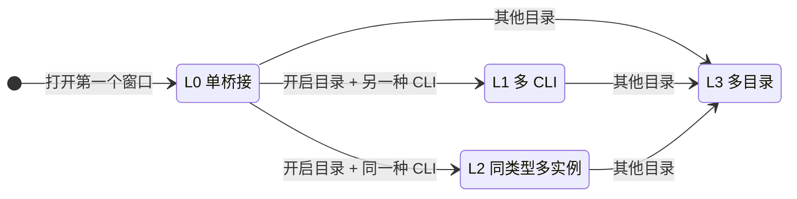
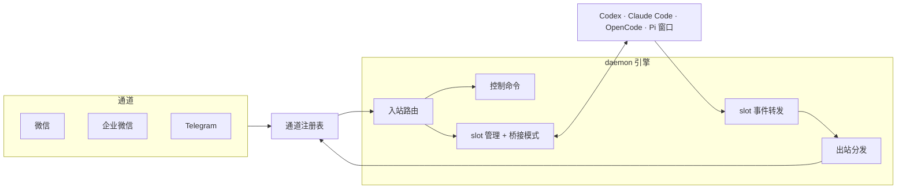

# 版本 1.3.0

**发布日期：** 2026 年 10 月 20 日

## 概览

1.3.0 是 CLI WeChat Bridge 迄今改动最大的一次发布，由两部分组成，后者建立在前者之上。

**重建的核心。** 到 1.2.3 为止，项目里并行运行着两套编排引擎：直接启动命令背后的独立 bridge，以及用于多 CLI 的 daemon。两者各自实现消息路由、审批和回复，行为会逐渐出现差异。1.3.0 起，所有直接启动命令、所有 daemon 以及 Codex 附加都运行在**同一套 daemon 引擎**上；这套引擎按职责拆分为独立模块，并建立了与通道无关的核心层。本次重建涉及 121 个文件，源码却从 40,737 行减少到 39,881 行，同时新增了多目录、多窗口和多模式支持。源码改动约 14,800 行（新增 6,961 行、删除 7,817 行），以往单个版本都不超过 3,000 行。

**渐进桥接模式。** 在这套引擎之上，桥接现在随你打开的窗口逐级扩展。它从干净的单桥接开始（回复不带标签、只显示单 CLI 命令），再扩展为四个级别之一：同一目录的多个 CLI、同一种 CLI 的多个窗口，或多个目录。每次升级都会通知你；桥接运行期间不会降级。

本版本同时以第三个包名 `cli-chat-bridge` 发布，这是项目即将使用的、不绑定任何通道的新名称。

## 渐进桥接模式

大多数人只在一个项目里使用一种 CLI。从第一条消息就展示 `/cd`、`/all` 和四个 CLI 的名字，只会增加理解成本。渐进模式只在你需要时展示多桥接能力：在本机再打开一个窗口，就是"需要"的信号。不需要选择模式，也不需要修改配置。



**开启目录**是第一个窗口所在的目录。L1、L2 只发生在开启目录里；在其他任何目录打开窗口都会进入 L3。

### L0 单桥接

第一个窗口，例如在 `~/app` 中运行 `wechat-pi`。消息直接交给 Pi，回复原样发回，**不带标签**。欢迎语只列出单 CLI 命令（`/stop`、`/status`、`/model`、`/plan`、`/resume`、`/new`、`/confirm`、`/deny`、`/answer`、`/lang`）。在聊天软件里发送 `/open` 会再开一个同类型窗口（进入 L2），发送 `/codex` 等会在当前目录打开另一种 CLI（进入 L1）。

### L1 多 CLI

在开启目录再打开另一种 CLI，例如在 Pi 旁边运行 `wechat-opencode`。由你决定下一条消息交给谁：

| 指令 | 作用 |
| --- | --- |
| `/pi`、`/opencode`、`/codex`、`/claude` | 切换 CLI；当前目录没有时在当前目录打开 |
| `/opencode 修复失败的测试` | 切换后把后面的内容发给 OpenCode |
| `/all <prompt>` | 把同一段提示词发给所有 CLI；任一 CLI 忙碌时整条取消 |

回复带 `[pi]`、`[opencode]` 标签。这一级每种 CLI 只有一个窗口，因为 `/pi` 表示"切换到 Pi"，无法区分两个 Pi。

### L2 同类型多实例

在开启目录再打开同一种 CLI（运行两次 `wechat-pi`，或发送 `/open`），让同一个 CLI 并行处理几件事：一个窗口写功能，另一个窗口跑测试。

| 指令 | 作用 |
| --- | --- |
| `/1`、`/2` | 切换到对应编号的窗口 |
| `/2 跑一下集成测试` | 切换后把后面的内容发给 2 号窗口 |
| `/open` | 再开一个窗口，使用最小的空闲编号 |
| `/pi` | 切换到最近使用的那个 Pi 窗口 |
| `/all <prompt>` | 把同一段提示词发给所有窗口 |

回复带 `[pi-1]`、`[pi-2]` 标签。编号按"目录 + CLI"计算：`pi-2` 关闭后，`pi-1`、`pi-3` 编号不变，下一个新窗口使用 2。`/stop`、`/model`、`/resume` 等命令作用于当前选中的窗口。每个编号窗口有独立的 endpoint 文件（`pi-2-companion-endpoint.json`）和会话文件（`slot-session-pi-2.json`）；1 号窗口沿用原有文件名，现有状态继续有效。

### L3 多目录

任一级别下，在其他目录打开任意 CLI。L3 是完整的管理模式，不再有任何限制，按"目录 / CLI / 编号"三级寻址：

| 指令 | 作用 |
| --- | --- |
| `/cd`、`/cd 2`、`/cd lib` | 列出所有目录及其窗口；按编号或名称切换 |
| `/codex`、`/claude` 等 | 在当前目录中切换 CLI，需要时在当前目录打开 |
| `/1`、`/2`、`/open` | 在当前 CLI 的多个窗口之间切换或新开 |
| `/all <prompt>` | 只发给**当前目录**，避免提示词误发到其他项目 |

回复带 `[目录/cli]` 标签，同一目录同一 CLI 有多个窗口时带编号（`[app/pi-2]`）。其他窗口中等待的审批和问题会由 `/confirm`、`/deny`、`/answer` 列出，可以直接用 `/confirm <编号>`、`/answer #<编号>` 处理，无需先切换过去。

### 保证行为可预期的规则

- **同一目录中 L1 与 L2 互斥。** 混在一起时，`/pi` 会同时表示"切换到 Pi"和"几个 Pi 中的一个"。被拒绝的启动命令会在终端说明原因，并建议改到其他目录（L3）或先关闭这些窗口。
- **只升不降。** 关闭窗口不会退回低一级，聊天软件里的命令和标签保持稳定。L2 中只剩一个窗口时，回复仍带 `[pi-1]`。
- **每次升级都有通知，** 列出新开放的命令；三种升级的通知各不相同。
- **远程打开跟随当前窗口：** `/codex`、`/open` 等在当前选中窗口所在的目录启动 CLI；还没有窗口时使用 daemon 的启动目录。
- **附加的 Codex 会话也算一个窗口，** `--attach-current-session` 遵守同样的规则。
- `/status` 显示当前模式和窗口编号。

各级别的架构图见 README 的[渐进桥接模式](https://github.com/UNLINEARITY/CLI-WeChat-Bridge/blob/main/README.md#渐进桥接模式)一章。

## 底层：一套引擎



### 从两套引擎到一套

- **启动命令成为引擎的窗口。** `wechat-codex`、`wecom-claude`、`telegram-pi` 等直接启动命令在当前终端运行 CLI，并在任意目录加入该通道正在运行的 daemon；没有 daemon 时拉起一个临时 daemon，最后一个窗口关闭后自动退出。1,926 行的独立 bridge 已移除。
- **`wechat-daemon` 是常驻服务。** 已有 daemon 时再运行，会把它转为常驻，而不是替换它，原有窗口和级别保持不变。常驻 daemon 启动时没有窗口，所有窗口关闭后重新开始。
- **Codex 附加接入引擎，** 作为一个无窗口的 Codex 窗口加入，不再因为 daemon 在运行而拒绝。
- **合并前先锁定行为。** 移除独立 bridge 之前，先用对照测试记录了它的行为以及需要改变的部分；只覆盖独立 bridge 路径的测试被移除，或迁移到它们实际测试的核心模块。

### 职责单一的模块与通道无关的核心

- **daemon 按职责拆分。** 原来 3,569 行的 daemon 文件拆分为 slot 管理、桥接模式、入站路由、控制命令、slot 事件转发、可见客户端启动、IPC 服务、启动清理、命令行解析和会话存储等模块。各模块只通过显式的 host 回调访问 daemon 状态，装配文件现在为 954 行。
- **统一的通道注册表** 负责为微信、企业微信、Telegram 和本地测试通道构建凭据、传输层、driver、出站端口和待发消息文件，编排层不再按通道 id 分支。
- **与通道无关的核心层。** 出站分发、待发消息存储和入站消息类型移入 `src/core`，服务于所有通道的代码不再使用微信命名。面向用户的文案、日志、通道 id 和已保存的数据保持不变。
- **拆分 `bridge-utils`：** 1,432 行拆分为出站附件、审批检测、消息格式化和用户问题消息四个模块。
- **slot 按"目录 + CLI + 实例编号"区分，** 这是多目录和多窗口能力的基础结构。

### 引擎带来的新能力

- **一个 daemon 服务多个项目目录，** 窗口标题带目录名，`/cd` 只能切换到本机已打开的目录。
- **跨窗口处理审批与问题，** 支持带编号的 `/confirm`、`/deny` 和 `/answer #<编号>`。
- **会话恢复：** daemon 把每个窗口跟随的会话保存到 `~/.cli-bridge/workspaces/<目录>/slot-session-<cli>.json`，`--session-start-mode restore` 可以恢复它。默认仍然新建会话；旧版独立 bridge 记录的会话会作为一次性回退读取。

## 修复与改进

- **Codex 窗口关闭后释放 slot：** 以前关闭 Codex 窗口后，它的 slot 会一直保留，临时 daemon 也因此不会退出。现在 daemon 每 3 秒检查一次窗口是否存活，四种 CLI 行为一致：窗口消失，或 60 秒内一直没有连接，就释放对应的 slot。
- **识别 Telegram daemon：** 以前正在运行的 `telegram-daemon` 会被启动命令误认为微信 daemon。现在 daemon endpoint 会保留 Telegram 和 local 通道的 id。
- **更清楚的提示：** 等待窗口连接前先发送"正在打开"提示；新 Codex 窗口的第一个线程、关闭过程中 CLI 的退出不再通知；本地 Codex 任务进行中收到的聊天消息会排队，任务结束后再发送。
- **更干净的日志：** 控制命令只记录命令词，不记录提示词内容。
- **按安装包给出提示：** 诊断信息和 `--doctor` 中的重装提示会写出你实际安装的包名。

## `cli-chat-bridge` 包

同一份构建同时以 `cli-chat-bridge`、`cli-wechat-bridge` 和 `@unlinearity/cli-wechat-bridge` 发布。项目已经通过与通道无关的核心支持三种聊天通道，新名称反映了这一点。目前三个包内容完全相同、同时发布；`scripts/publish-dual.mjs` 只构建一次，依次发布三个包，已发布的版本自动跳过。

## 升级与兼容性说明

### 安装与重启

```bash
npm install -g cli-wechat-bridge@1.3.0
```

scoped 兼容包和新包名提供同一版本：

```bash
npm install -g @unlinearity/cli-wechat-bridge@1.3.0
npm install -g cli-chat-bridge@1.3.0
```

三个包提供相同的命令，只需安装其中一个。要切换包名，请先卸载当前的包，例如 `npm uninstall -g cli-wechat-bridge && npm install -g cli-chat-bridge@1.3.0`；否则 npm 会因 `EEXIST` 中止安装。

停止正在运行的 bridge、daemon 和可见 CLI 窗口后重新启动，以加载新代码。通道凭据无需迁移。

### 行为变化

- **独立 bridge 已移除。** 直接启动命令始终通过 daemon 引擎运行。在其他目录运行启动命令时，会把该目录加入正在运行的桥接（L3），而不是切换活动工作区；源码脚本 `npm run bridge*` 已删除。
- **回复标签取决于级别。** 单桥接的回复不再带 `[codex]` 这类标签。解析回复标签的脚本需要适配：L0 没有标签，L2 为 `[pi-1]`，L3 为 `[目录/cli]`。
- **同一目录再次启动同一种 CLI** 现在会打开一个编号窗口（L2），而不是被拒绝；在 L1 中仍然会被拒绝。
- **`/cd` 与 `/all` 只在需要它们的级别开放，** 其他级别会回复说明。
- **远程打开不再只限于启动目录，** 改为使用当前选中窗口所在的目录。
- **Claude 思考过程转发已移除，** 同时删除了需要手动开启的 `CLI_BRIDGE_THINKING_FORWARD` 开关。最终回复、审批和问题不受影响。

### 运行限制

- Node.js 仍要求 `>=22.13.0`，Pi 要求 `>=22.19.0`。Codex 常规桥接仍验证 0.149.x–0.161.x；附加模式需要 Codex >=0.162 的共享 daemon。
- 每个数据目录仍然只运行一个通道的 daemon。启动另一个通道前，需要先停止当前通道的 daemon。
- 桥接模式只保存在 daemon 内存中；重启 daemon 后从 L0 重新开始。

## 发布验证

- **环境与质量：** 在 macOS、Node.js 24.20.0 与 Bun 1.4.3 下，Lint、严格源码类型检查、全部 897 项测试与构建均通过。新增测试覆盖模式迁移表的每一行、各类拒绝、只升不降与常驻 daemon 重置、编号窗口并存（endpoint、会话文件与启动参数互不干扰）、`/open`、`/1`、`/all`、`/status`、回复标签、Codex 附加计为窗口，以及两个镜像包。
- **包内容：** `npm pack --dry-run --json` 共 131 个文件、21 个命令入口，包含 `bin/`、`dist/`、两份 README、`LICENSE.txt` 与 Codex bridge skill；不包含源码、测试、内部文档、运行状态、本地日志与 `node_modules/`。
- **全局安装：** `npm run smoke:global -- --purge-global --clean-cache --full` 通过真实 tarball 安装、仓库外全部 15 个安全启动命令检查与完整质量门禁。冒烟脚本现在安装前也会清理已安装的 `cli-chat-bridge`。
- **CLI 能力：** `npm run smoke:cli-compat` 在 Codex 0.163.0、Claude Code 2.1.304、OpenCode 2.0.18 与 Pi 1.1.0 下通过；Pi 探针加载真实 bridge extension 并检查模型列表 IPC。
- **发布预检：** `npm publish --dry-run --access public` 与 `npm run publish:dual -- --dry-run` 对 `cli-wechat-bridge`、`@unlinearity/cli-wechat-bridge`、`cli-chat-bridge` 三个包均通过，各 131 个文件。

以上检查覆盖本地回归、包安装与 CLI 接口。渐进模式、编号窗口与 daemon 引擎的改动尚未在真实微信、企业微信或 Telegram 账号上端到端实测；dry-run 不等于已发布到 registry。
